# Custom-Firmware: Anleitung

Deutsch · [English](en.md)

Diese Anleitung zeigt, wie du die Custom-Firmware (CFW) der Toniebox mit der
Weboberfläche von teddyCloud nutzt: die Unterstützung
einschalten, die Firmware auf eine Box bringen und jede Funktion, die sie
mitbringt. Die Bilder stammen aus einer Testinstallation mit einer simulierten
Box; Namen und Werte sind Beispiele.

Die Custom-Firmware ist im Test. Das Ändern der Firmware einer Box geschieht
auf eigenes Risiko (siehe „Legal“ in der [README](../../README.md#legal)).

## Inhalt

1. [So greifen die Teile ineinander](#1-so-greifen-die-teile-ineinander)
2. [CFW-Unterstützung einschalten](#2-cfw-unterstützung-einschalten)
3. [Die Custom-Firmware auf eine Box bringen](#3-die-custom-firmware-auf-eine-box-bringen)
4. [Die Setup-Seite der Box](#4-die-setup-seite-der-box)
5. [Die Box in teddyCloud](#5-die-box-in-teddycloud)
6. [Box-Einstellungen](#6-box-einstellungen)
7. [Tonie-Einstellungen](#7-tonie-einstellungen)
8. [Event-Tags](#8-event-tags)
9. [Globales Fortsetzen](#9-globales-fortsetzen)
10. [Fernbedienung](#10-fernbedienung)
11. [Box Update](#11-box-update)
12. [Gesten an der Box](#12-gesten-an-der-box)
13. [Zurück zur Original-Firmware](#13-zurück-zur-original-firmware)
14. [Fragen und Probleme](#14-fragen-und-probleme)

## 1. So greifen die Teile ineinander

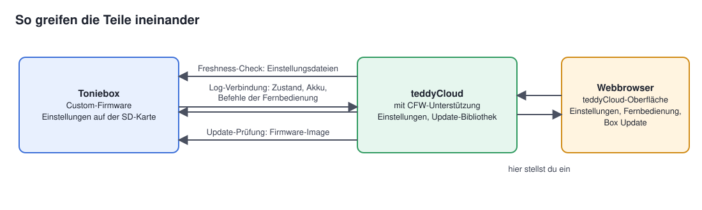

- **teddyCloud mit CFW-Unterstützung** verwaltet die Einstellungen deiner
  Boxen und Tonies, die Firmware-Bibliothek und den Zustand, den jede Box
  meldet.
- **Die Box** holt ihre Einstellungen beim üblichen Freshness-Check und
  speichert sie auf der SD-Karte, sie wirken also auch ohne Netz. Eine zweite
  Verbindung (die Log-Verbindung) trägt Zustand, Akku und die Befehle der
  Fernbedienung.
- **Du** stellst alles in der Weboberfläche ein. Eine Box ohne
  CFW-Einstellungen verhält sich wie mit der Original-Firmware, bis auf die
  Gesten aus [Kapitel 12](#12-gesten-an-der-box).

Gegenüber teddyCloud und der Boxine-Cloud gibt sich die Box als
Original-Firmware aus. Sie läuft deshalb auch mit einem teddyCloud ohne
CFW-Unterstützung; dann fehlen nur die Funktionen dieser Anleitung.

## 2. CFW-Unterstützung einschalten

Die CFW-Unterstützung ist anfangs aus; ohne sie verhält sich teddyCloud genau
wie ohne CFW-Unterstützung. Öffne **Tonieboxen → Box Update** und klicke
**CFW-Unterstützung einschalten**:

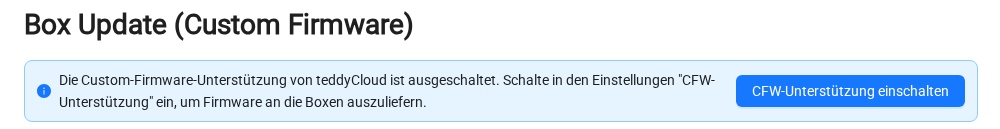

Die allgemeinen CFW-Optionen stehen unter **Einstellungen**, Abschnitt
**Custom Firmware** (einige erst im Settings level *Detail* oder *Expert*):

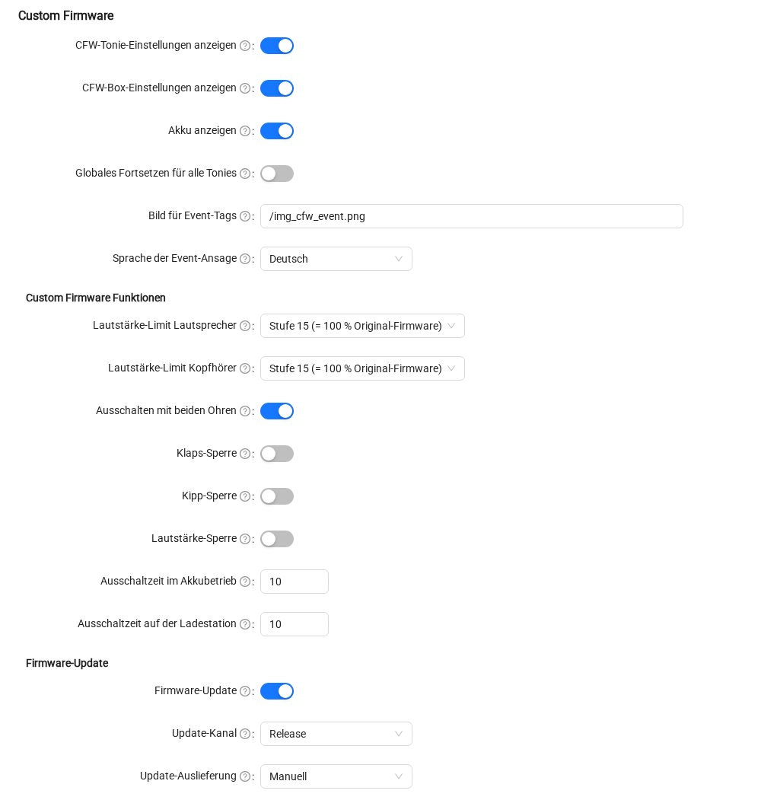

| Option | Bedeutung |
| --- | --- |
| CFW-Tonie-Einstellungen anzeigen | Zeigt den Teil *Custom Firmware* im Bearbeiten-Dialog eines Tonies. Schaltet sich von selbst ein, sobald sich die erste CFW-Box meldet. |
| CFW-Box-Einstellungen anzeigen | Zeigt den Teil *Custom Firmware* in den Box-Einstellungen. |
| Akku anzeigen | Akkustand auf der Karte der Box. |
| Globales Fortsetzen für alle Tonies | Jeder Tonie ohne eigene Einstellungen spielt boxübergreifend weiter ([Kapitel 9](#9-globales-fortsetzen)). |
| Bild für Event-Tags, Sprache der Event-Ansage | Bild der Event-Tags in den Listen und die Sprache der Ansage, die eine Box mit Original-Firmware bei einem Event-Tag spielt. |
| Custom Firmware Funktionen | Die Vorgaben für alle Boxen: Lautstärke-Limits, Ausschalten mit beiden Ohren, die drei Sperren, die Ausschaltzeiten im Akkubetrieb und auf der Ladestation. Jede Box kann sie überschreiben ([Kapitel 6](#6-box-einstellungen)). |
| Firmware-Update | Update an oder aus, Kanal und Auslieferung für alle Boxen ([Kapitel 11](#11-box-update)). |

## 3. Die Custom-Firmware auf eine Box bringen

Der Weg hängt von zwei Dingen ab: welchen Chip die Box hat (**Tonieboxen →
Toniebox hinzufügen → Version identifizieren**) und ob sie noch ganz original
ist oder schon mit teddyCloud läuft.

| | Box noch original | Box läuft schon mit teddyCloud |
| --- | --- | --- |
| **CC3200** | Box öffnen und flashen, im Browser oder auf der Kommandozeile, danach die SD-Karte vorbereiten | nur die SD-Karte vorbereiten |
| **ESP32** | Box öffnen und mit dem ESP32-Flasher flashen, Custom-Firmware gleich mit | über teddyCloud, ohne die Box zu öffnen |

Für jeden Weg zuerst:

1. Die CFW-Unterstützung einschalten ([Kapitel 2](#2-cfw-unterstützung-einschalten)).
2. Das Release-Paket `toniebox-cfw-….zip` in die Bibliothek von **Box
   Update** laden, per Upload oder Download von GitHub ([Kapitel 11](#11-box-update)).
   Die Flasher und das SD-Karten-Zip nehmen die Firmware von dort.

**Box Update → Custom-Firmware auf eine Box bringen** zeigt die Schritte für
eine Box, die schon mit teddyCloud läuft, mit der Adresse deines Servers
schon eingetragen.

### Box mit CC3200-Chip

Die CC3200-Box startet die Custom-Firmware von der SD-Karte. Die
Original-Firmware bleibt unverändert im Flash und lässt sich jederzeit wieder
starten ([Kapitel 13](#13-zurück-zur-original-firmware)).

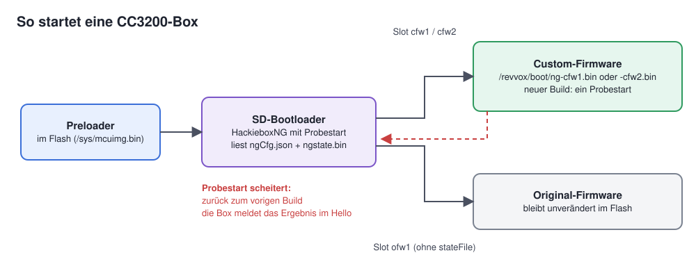

**Box noch original.** Öffne die Box und wähle unter **Toniebox hinzufügen →
CC3200**:

- **Im Browser** (Chrome oder Edge am Rechner, teddyCloud über HTTPS
  geöffnet; Verbindung über einen UART-Adapter oder einen ESP32-C3): Die Seite
  sichert den Flash, liest die Zertifikate der Box, tauscht das
  CA-Zertifikat gegen das von teddyCloud und installiert den Bootloader, alles
  über die serielle Schnittstelle. Danach bietet sie den fertigen Inhalt der
  SD-Karte zum Herunterladen an: Bootloader, Custom-Firmware, Setup-Seite und
  dein Server. Entpacke ihn ins Hauptverzeichnis der Karte.
- **Kommandozeile:** dieselben Schritte mit den Werkzeugen von HackieboxNG;
  danach die SD-Karte vorbereiten wie im nächsten Absatz.

Bewahre die Sicherung des Flash gut auf.

**Box läuft schon mit teddyCloud** (der HackieboxNG-Bootloader ist
installiert, das Zertifikat von teddyCloud im Flash): Dann reicht die
SD-Karte. **Toniebox hinzufügen → CC3200 → Nur SD-Karte** baut den ganzen
Karteninhalt als Zip aus dem Release-Paket; entpacke es ins Hauptverzeichnis
der Karte.

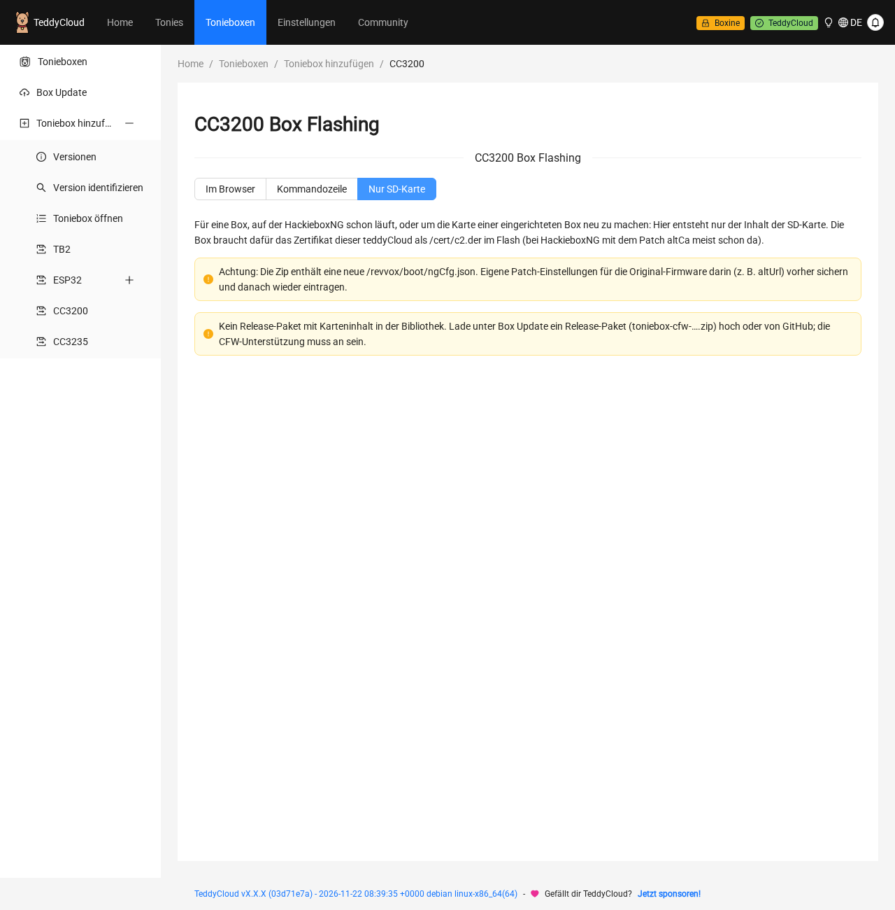

Das Zip enthält eine neue `/revvox/boot/ngCfg.json`. Hast du dort eigene
Patch-Einstellungen für die Original-Firmware (zum Beispiel `altUrl`),
sichere sie vorher und trage sie danach wieder ein.

Von Hand sind es diese Schritte:

1. Den Inhalt von `cc3200/card/` aus dem Paket ins Hauptverzeichnis der
   Karte kopieren. Darin sind der Bootloader mit Probestart und automatischer
   Rückkehr, die Firmware als `/revvox/boot/ng-cfw1.bin`, die
   Boot-Zustandsdatei `/revvox/boot/ngstate.bin`, die `ngCfg.json` mit
   `"activeImg": "cfw1"` und `"stateFile"` sowie die Setup-Seite
   `/cfw/setup.htm`.
2. Den Server in `/cfw/config.txt` eintragen: `host=<dein teddyCloud>` und bei
   Bedarf `port=`.
3. Karte einsetzen und die Box starten. Sie meldet sich bei teddyCloud und
   steht unter **Tonieboxen** mit der Markierung *CFW*.

### Box mit ESP32-Chip

Die ESP32-Box hat zwei Slots für die Firmware im Flash. Die Custom-Firmware
kommt in den freien Slot; die Original-Firmware bleibt im anderen.

**Box noch original.** Öffne die Box und flashe sie unter **Toniebox
hinzufügen → ESP32** (Chrome, Edge oder Firefox ab Version 151, teddyCloud
über HTTPS). Der Flasher sichert zuerst den ganzen Flash. Im Schritt
**Flashen** wählst du **Custom-Firmware** statt „Original-Firmware (für
teddyCloud gepatcht)“. Die Custom-Firmware startet gleich nach dem Flashen.

- Bestätigt sie sich dreimal hintereinander nicht, startet die Box wieder die
  Original-Firmware.
- Bewahre den Flash-Dump gut auf und lade ihn in die Bibliothek von **Box
  Update**. Damit kommt die Box später ohne Öffnen zur Original-Firmware
  zurück.

**Box läuft schon mit teddyCloud** (die für teddyCloud gepatchte
Original-Firmware): Die Box bekommt die Custom-Firmware über teddyCloud und
muss nicht geöffnet werden.

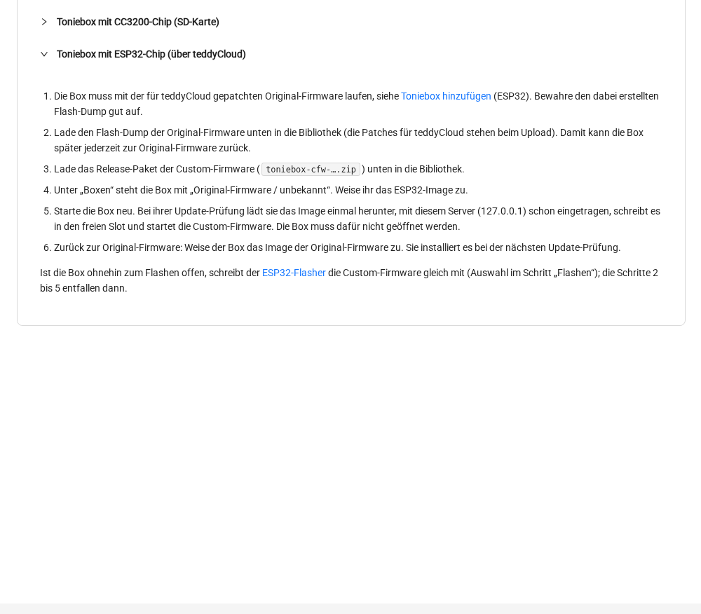

1. Lade den Flash-Dump vom Flashen der Box in die Bibliothek von **Box
   Update**. Damit kann die Box jederzeit zur Original-Firmware zurück.
2. Unter **Boxen** steht die Box als *Original-Firmware / unbekannt*. Weise
   ihr das ESP32-Image aus dem Release-Paket zu.
3. Starte die Box neu. Bei ihrer Update-Prüfung lädt sie das Image einmal
   herunter, mit deinem Server schon eingetragen, schreibt es in ihren freien
   Slot und startet die Custom-Firmware.

## 4. Die Setup-Seite der Box

Die Custom-Firmware bringt eine eigene Setup-Seite mit. Halte beide Ohren 5
Sekunden, damit die Box in den Einrichtungsmodus geht, verbinde dich wie bei
der Original-Einrichtung mit dem WLAN der Box und öffne die Seite.

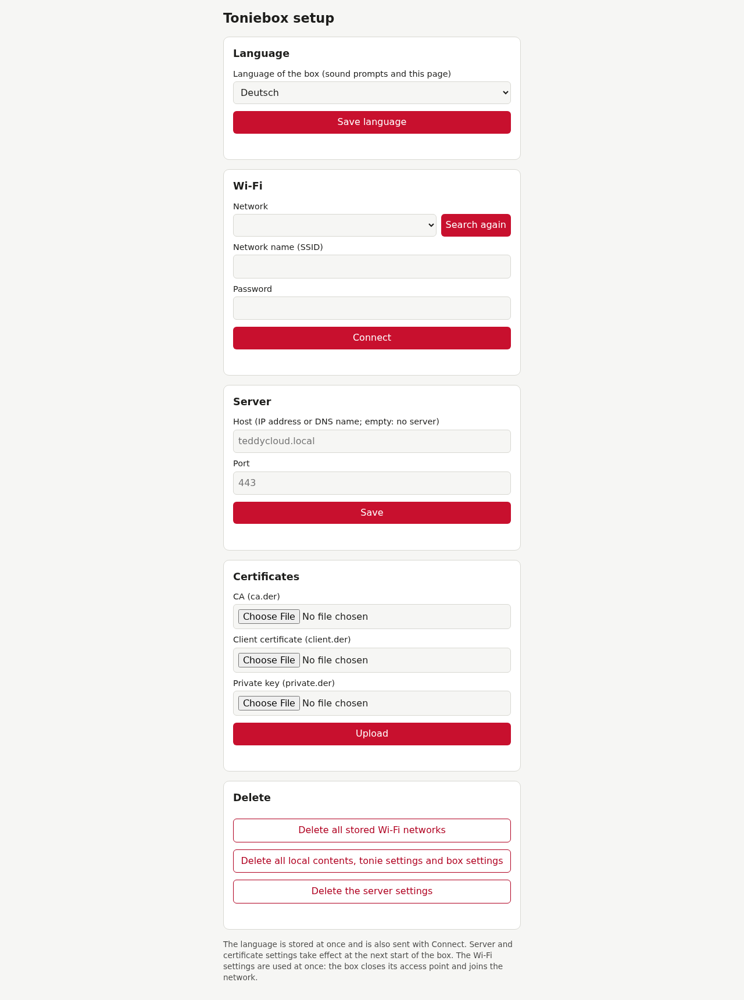

- **Sprache** der Ansagen der Box und dieser Seite.
- **WLAN:** ein Netz aus der Liste wählen oder seinen Namen eintippen.
- **Server:** Host und Port deines teddyCloud (leerer Host: kein Server).
- **Zertifikate:** `ca.der`, `client.der` und `private.der` hochladen.
- **Löschen:** alle gespeicherten WLANs, alle lokalen Inhalte samt Tonie- und
  Box-Einstellungen oder die Server-Einstellungen. Das ersetzt den
  Werksreset der Original-Firmware.

teddyCloud hält die Seite aktuell: Ein Release-Paket bringt seine Seite mit,
und eine Box bekommt eine neuere beim nächsten Start ([Kapitel 11](#11-box-update)).

### Direkt auf der SD-Karte

Ohne Setup-Seite lässt sich einiges auch direkt auf der SD-Karte ändern: Box
ausschalten, Karte in den Rechner, ändern, Karte zurück, Box starten.

**Server:** `/cfw/config.txt` ist eine Textdatei mit einer Einstellung pro
Zeile; Zeilen mit `#` sind Kommentare. Die Box liest sie bei jedem Start.

| Zeile | Bedeutung |
| --- | --- |
| `host=…` | Name oder IP-Adresse deines teddyCloud |
| `port=…` | Port, ohne die Zeile 443 |
| `ca=…` | nur CC3200: Name der CA-Datei im Flash, ohne die Zeile `ca.der`. Für Boxen mit dem Alternativ-CA-Patch von HackieboxNG `ca=c2.der` |

Fehlt die Datei oder ist `host` ungültig, verbindet sich die Box mit keinem
Server. Inhalte, die schon auf der Karte liegen, spielen trotzdem.

**Zertifikate (nur CC3200):** Lege `ca.der`, `client.der` und/oder
`private.der` in den Ordner `/cfw/cert/`. Beim nächsten Start schreibt die Box
sie in ihren Flash und löscht sie danach von der Karte, damit der private
Schlüssel dort nicht liegen bleibt. Eine Datei, die kein gültiges Zertifikat
ist, bleibt auf der Karte und ändert nichts. Die Original-Firmware nutzt
dieselben Zertifikate. Bei der ESP32-Box gehen Zertifikate nur über die
Setup-Seite; die Zertifikate der Original-Firmware bleiben dabei unverändert.

**Tonie- und Box-Einstellungen** liegen unter `/cfw/ext/`. Das sind
Binärdateien mit Prüfsumme, die teddyCloud schreibt; sie lassen sich nicht von
Hand bearbeiten. Ändere sie in teddyCloud.

## 5. Die Box in teddyCloud

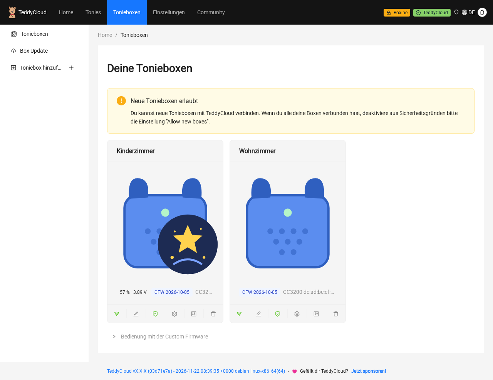

Die Karte einer CFW-Box zeigt:

- den **Akku**: Prozent und Spannung. Die Prozente zählen die Laufzeit seit
  dem letzten Laden und lernen die Kapazität der Zelle; der Tooltip nennt die
  verbleibende Laufzeit und wann sich die Box zuletzt gemeldet hat.
- die Markierung **CFW** mit dem Build-Datum (Tooltip: die Build-Nummer).
- den Knopf der **Fernbedienung** (Regler-Symbol, [Kapitel 10](#10-fernbedienung)).

**Bedienung mit der Custom Firmware** unter den Karten klappt eine kurze
Übersicht der Gesten und Funktionen auf:

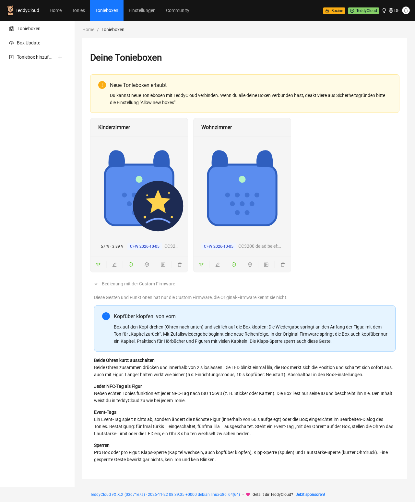

## 6. Box-Einstellungen

Das Zahnrad der Karte öffnet die Einstellungen der Box. Mit eingeschalteter
CFW-Unterstützung enthalten sie einen Teil **Custom Firmware**:

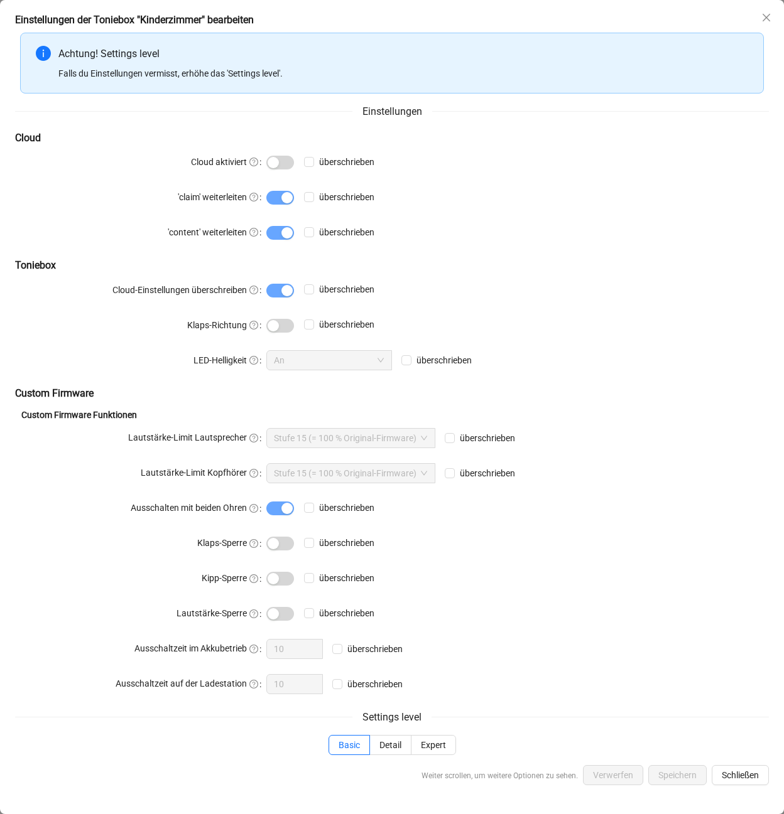

Ein Wert der Box zählt nur, wenn daneben **überschreiben** angehakt ist; sonst
nimmt die Box den Wert der allgemeinen Einstellungen ([Kapitel 2](#2-cfw-unterstützung-einschalten)).

| Einstellung | Wirkung |
| --- | --- |
| Lautstärke-Limit Lautsprecher / Kopfhörer | Höchste Lautstärke in allen 16 Stufen (0 bis 15). Das Original kennt nur 4 Stufen. |
| Ausschalten mit beiden Ohren | Beide Ohren kurz drücken: Die Box schaltet aus ([Kapitel 12](#12-gesten-an-der-box)). |
| Klaps-Sperre | Klopfen wechselt kein Kapitel mehr (auch nicht kopfüber). |
| Kipp-Sperre | Kippen spult nicht mehr vor oder zurück. |
| Lautstärke-Sperre | Kurzer Ohrdruck ändert die Lautstärke nicht mehr; Ohr halten und die Gesten mit beiden Ohren gehen weiter. |
| Ausschaltzeit im Akkubetrieb / auf der Ladestation | Minuten ohne Wiedergabe, bis sich die Box selbst ausschaltet (1 bis 65535; Vorgabe 10 wie im Original). |

Die **LED-Helligkeit** steht im Teil *Toniebox* derselben Einstellungen. Sie
gilt, während die Box bereit ist:

| Wert | Wirkung |
| --- | --- |
| An | Die LED leuchtet hell. |
| Gedimmt | Nach der Hell-Phase (3 Sekunden hell, 2 Sekunden Übergang) leuchtet die LED schwach; jede Bedienung macht sie wieder hell. |
| Aus | Wie gedimmt, nur geht die LED nach der Hell-Phase aus. |
| Dauerhaft gedimmt | Nur Custom-Firmware: Die LED ist sofort schwach, ohne Hell-Phase, auch bei Bedienung. Alle anderen Anzeigen leuchten ebenfalls gedimmt, auch das Blinken beim Laden eines Inhalts. |
| Dauerhaft aus | Nur Custom-Firmware: Die LED ist sofort aus, ohne Hell-Phase, auch bei Bedienung. Alle anderen Anzeigen leuchten gedimmt, das Blinken beim Laden eines Inhalts entfällt. |

Boxen mit Original-Firmware bekommen statt der dauerhaften Werte „Gedimmt“
bzw. „Aus“.

Eine gesperrte Geste bewirkt gar nichts: kein Ton, kein Blinken. Was an der
Box selbst geändert wird (per Event-Tag oder mit den Ohren), kommt zu
teddyCloud zurück und erscheint hier.

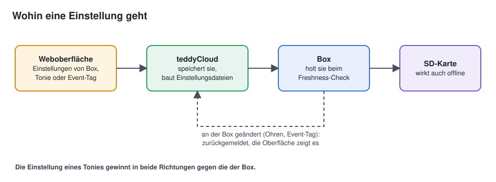

## 7. Tonie-Einstellungen

Öffne **Tonies**, klicke den Stift eines Tonies (oder eines beliebigen
NFC-Tags) und wähle im Teil *Custom Firmware* **Verwendung: Figur mit Profil**:

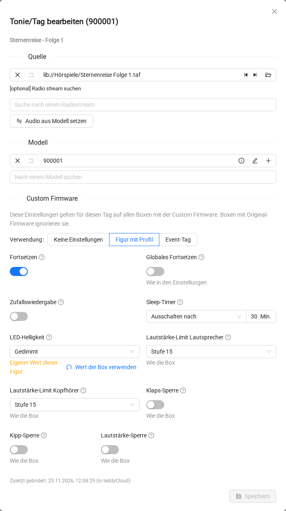

| Einstellung | Wirkung |
| --- | --- |
| Fortsetzen | Der Tonie spielt dort weiter, wo er aufgehört hat, auch wenn zwischendurch andere Tonies liefen oder die Box aus war. Ist der Inhalt zu Ende, beginnt er beim nächsten Mal von vorn. |
| Globales Fortsetzen | Spielt boxübergreifend weiter ([Kapitel 9](#9-globales-fortsetzen)). Schließt Fortsetzen ein. |
| Zufallswiedergabe | Inhalte mit 2 bis 99 Kapiteln spielen jedes Kapitel einmal in zufälliger Reihenfolge; Klopfen bewegt sich durch diese Reihenfolge. Siehe unten. |
| Sleep-Timer | Nach N Minuten ausschalten. Im ersten Drittel bleibt die Lautstärke, dann wird sie bis zur Stille leiser. Abnehmen des Tonies hält den Timer an. |
| LED-Helligkeit | Einer der fünf Werte aus [Kapitel 6](#6-box-einstellungen), solange dieser Tonie aufliegt. |
| Lautstärke-Limits | Eigene Limits für Lautsprecher und Kopfhörer; dürfen höher sein als die der Box. |
| Klaps-, Kipp- und Lautstärke-Sperre | Nur für diesen Tonie. |

**Zufallswiedergabe, Fortsetzen und Kopfüber-Klopfen.** Wann die Box neu
mischt:

| | Derselbe Tonie wieder aufgelegt | Dazwischen lief ein anderer Tonie |
| --- | --- | --- |
| Zufallswiedergabe ohne Fortsetzen | weiter an derselben Stelle derselben Reihenfolge | neu gemischt, von vorn |
| Zufallswiedergabe mit Fortsetzen | weiter an derselben Stelle derselben Reihenfolge | weiter an derselben Stelle derselben Reihenfolge, auch nach dem Ausschalten |

Nach dem letzten Kapitel der Reihenfolge endet die Wiedergabe; beim nächsten
Auflegen wird neu gemischt. **Kopfüber klopfen** ([Kapitel 12](#12-gesten-an-der-box))
mischt jederzeit neu und beginnt die neue Reihenfolge von vorn.

Jeder Wert kann **Wie die Box** heißen: dann gilt die Einstellung der Box. Ein
Wert des Tonies gewinnt in beide Richtungen gegen den der Box. Die
Einstellungen gelten für diesen Tag auf jeder CFW-Box; Boxen mit
Original-Firmware ignorieren sie.

Jeder NFC-Tag nach ISO 15693 (Sticker, Karten) funktioniert wie ein Tonie:
Die Box liest nur seine ID und beschreibt ihn nie.

## 8. Event-Tags

Ein Event-Tag spielt nichts ab. Legst du ihn auf, ändert die Box
Einstellungen, ganz ohne teddyCloud: zum Beispiel einen Sleep-Timer für den
nächsten Tonie oder abends Lautstärke und LED der Box. Jeder übrige Tonie,
Kreativ-Tonie oder NFC-Sticker kann ein Event-Tag sein.

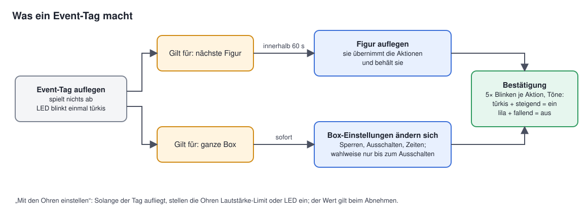

### Einrichten

1. Öffne **Tonies** und klicke den Stift des Tags.
2. Wähle im Teil *Custom Firmware* **Verwendung: Event-Tag**.
3. Wähle unter **Gilt für**, was der Tag ändert:
   - **Nächste Figur:** die Einstellungen des Tonies, den du danach
     auflegst.
   - **Ganze Box:** die Einstellungen der Box.
4. Füge mit **Aktion hinzufügen** die Aktionen hinzu. Jede hat einen Modus
   und, wo nötig, einen Wert (Tabellen unten).
5. Lege fest, ob es **Bestätigungstöne** gibt, und bei *Ganze Box*, ob die
   Änderung **Nur bis zum Ausschalten** gilt. Dann **Speichern**.

Die Box bekommt den Tag beim nächsten Freshness-Check (einen Tonie auflegen
oder die Box neu starten).

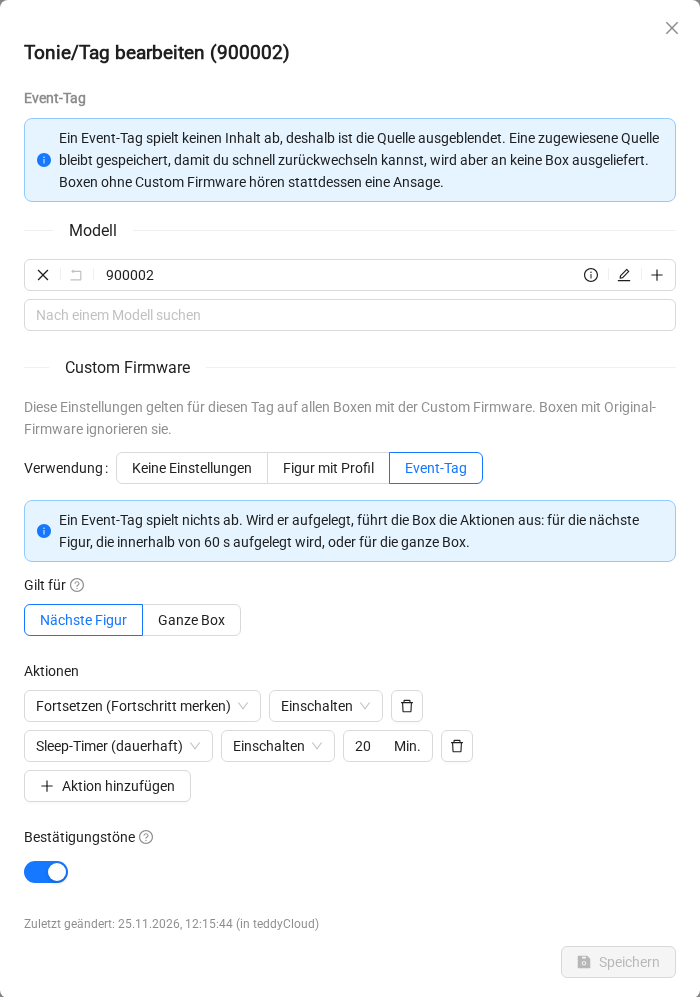

### Die Modi

| Modus | Wirkung |
| --- | --- |
| Einschalten / Ausschalten | setzt den Wert fest auf an bzw. aus |
| Umschalten | dreht den Wert um, der gerade gilt: an wird aus, aus wird an |
| Entfernen | löscht den eigenen Wert; danach gilt wieder die Vorgabe (beim Tonie: „Wie die Box“) |
| Mit den Ohren einstellen | Solange der Tag aufliegt, stellst du den Wert mit den Ohren ein (siehe unten) |

### Gilt für: nächste Figur

Lege den Event-Tag auf und nimm ihn wieder ab. Danach warten die Aktionen
60 Sekunden auf den nächsten Tonie. Dieser übernimmt sie in seine
Einstellungen und behält sie, bis sie wieder geändert werden. Kommt in den
60 Sekunden kein Tonie, verfallen sie ohne Anzeige.

| Aktion | Modi | Wert |
| --- | --- | --- |
| Fortsetzen, Zufallswiedergabe | Umschalten, Einschalten, Ausschalten, Entfernen | – |
| Klaps-, Kipp-, Lautstärke-Sperre der Figur | Umschalten, Einschalten, Ausschalten, Entfernen | – |
| Sleep-Timer (dauerhaft) | Umschalten, Einschalten, Ausschalten, Entfernen | Minuten |
| Sleep-Timer (einmalig) | – | Minuten; gilt für diesen Tonie, bis die Zeit abgelaufen ist, ein anderer Tonie aufgelegt wird oder die Box ausgeht (Abnehmen hält ihn nur an); die Einstellungen des Tonies bleiben |
| Lautstärke-Limit der Figur | Mit den Ohren einstellen, Entfernen | Startwert |
| LED-Helligkeit der Figur | Mit den Ohren einstellen, Entfernen | Startwert |
| Profil der Figur zurücksetzen | – | löscht alle Einstellungen des Tonies |

### Gilt für: ganze Box

Die Aktionen ändern die Einstellungen der Box. Sperren, das Ausschalten mit
beiden Ohren und die Ausschaltzeiten ändern sich sofort beim Auflegen.
Lautstärke-Limit und LED, die du mit den Ohren einstellst, gelten beim
Abnehmen. teddyCloud übernimmt die neuen Werte und zeigt sie in den
Box-Einstellungen ([Kapitel 6](#6-box-einstellungen)).

| Aktion | Modi | Wert |
| --- | --- | --- |
| Klaps-, Kipp-, Lautstärke-Sperre der Box | Umschalten, Einschalten, Ausschalten, Entfernen | – |
| Ausschalten mit beiden Ohren | Umschalten, Einschalten, Ausschalten, Entfernen | – |
| Ausschaltzeit im Akkubetrieb / auf der Ladestation | – | Minuten; 0 entfernt den Wert (dann 10 Minuten wie im Original) |
| Lautstärke-Limit der Box | Mit den Ohren einstellen, Entfernen | Startwert |
| LED-Helligkeit der Box | Mit den Ohren einstellen, Entfernen | Startwert |
| Sleep-Timer (einmalig, für die nächste Figur) | – | Minuten; wartet wie oben 60 Sekunden auf den nächsten Tonie |

### Nur bis zum Ausschalten

Diesen Schalter gibt es bei *Ganze Box*. Ist er an, gelten die Änderungen
des Tags nur, bis die Box ausgeht (auch bei einem Neustart). Die Box speichert
nichts und meldet nichts an teddyCloud; danach gelten wieder die
gespeicherten Einstellungen. Ändert sich dieselbe Einstellung zwischendurch
dauerhaft, endet der vorübergehende Wert.

Beispiel: Ein „Abend-Tag“, der für diesen Abend das Klapsen sperrt und
Lautstärke-Limit und LED mit den Ohren einstellen lässt. Am nächsten Morgen ist
alles wieder wie vorher.

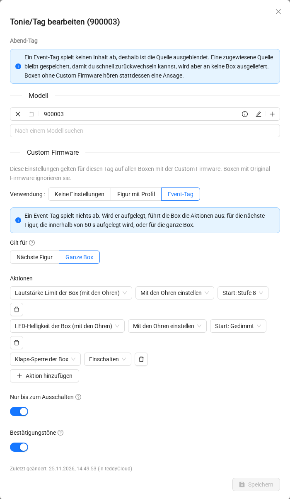

### Lautstärke-Limit mit den Ohren einstellen

1. Leg den Tag auf. Das Lautstärke-Limit beider Ausgänge ist jetzt ganz offen
   (Stufe 15), und die Lautstärke springt auf den **Startwert**: *aktuelle
   Lautstärke* lässt sie, wie sie ist; *Stufe N* stellt sie auf N.
2. Stell mit den Ohren die Lautstärke ein, die das neue Lautstärke-Limit sein soll.
3. Nimm den Tag ab. Die eingestellte Lautstärke wird das Lautstärke-Limit, und zwar für
   den Ausgang, der gerade spielt: Lautsprecher oder Kopfhörer.

Die Lautstärke-Sperre wirkt dabei nicht.

### LED-Helligkeit mit den Ohren einstellen

1. Leg den Tag auf. Die LED zeigt den **Startwert**: *aktuelle Helligkeit*
   oder die gewählte Stufe.
2. Jeder Druck auf ein Ohr geht eine Stufe weiter, durch alle fünf Stufen der
   Box-Einstellungen:

   | Stufe | Türkis blinken | danach |
   | --- | --- | --- |
   | An | 1× | hell |
   | Gedimmt | 2× | kurz hell, dann gedimmt |
   | Aus | 3× | dunkel |
   | Dauerhaft gedimmt | 4× | gedimmt |
   | Dauerhaft aus | 5× | dunkel |

   Nach „Dauerhaft aus“ kommt wieder „An“. Die Anzeige dauert jeweils 5
   Sekunden.
3. Nimm den Tag ab. Die gezeigte Stufe gilt.

**Beides auf einem Tag:** Die Ohren stellen zuerst die Lautstärke ein. Ein Ohr
3 Sekunden halten wechselt zur LED (die Stufe wird gezeigt), noch einmal
halten zurück zur Lautstärke (einmal türkis blinken). Beim Abnehmen gelten
beide Werte.

### Bestätigung

Hat die Box die Aktionen ausgeführt, bestätigt sie einmal für alle:

| Ergebnis | LED (5 Sekunden) | Töne je Aktion |
| --- | --- | --- |
| alles eingeschaltet | fünfmal türkis | steigend |
| alles ausgeschaltet | fünfmal lila | fallend |
| gemischt | abwechselnd türkis und lila | je Aktion steigend oder fallend |

**Bestätigungstöne** aus schaltet die Töne für diesen Tag ab; das Blinken
bleibt. Ein Tag für die nächste Figur zeigt schon beim Auflegen ein kurzes
türkises Blinken: Er ist angenommen.

Eine Box mit Original-Firmware spielt bei einem Event-Tag stattdessen eine
kurze Ansage (Sprache in den Einstellungen).

## 9. Globales Fortsetzen

Ein Tonie mit **Globales Fortsetzen** spielt auf jeder CFW-Box dort weiter, wo
er auf einer anderen aufgehört hat, wie eine Kassette. Jede Box meldet die
Position an teddyCloud und fragt beim Auflegen nach dem letzten Stand. Inhalt,
den die Box noch nicht hat, wird zuerst geladen.

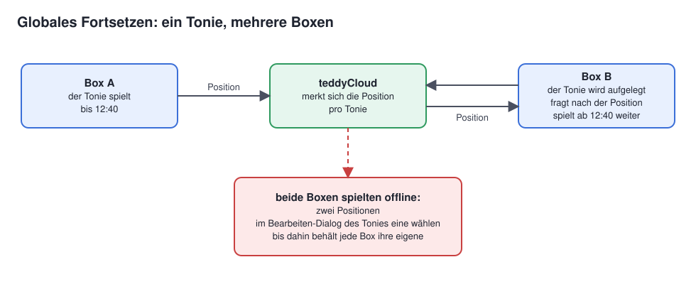

Einschalten lässt es sich pro Tonie ([Kapitel 7](#7-tonie-einstellungen))
oder mit **Globales Fortsetzen für alle Tonies** in den Einstellungen für
jeden Tonie ohne eigene Einstellungen (ohne Live-Inhalte und Streams). Der
Bearbeiten-Dialog des Tonies zeigt, wo er zuletzt gehört wurde und auf
welcher Box er gerade spielt. Er nennt auch Boxen, deren Firmware noch kein
globales Fortsetzen kann.

### Was es kostet

Globales Fortsetzen braucht teddyCloud bei jedem Auflegen. Das hat seinen
Preis:

- **Warten vor dem Abspielen.** Die Box spielt erst, wenn teddyCloud den Stand
  genannt hat. Ist sie verbunden, dauert das bis zu 3 Sekunden. Kurz nach dem
  Einschalten oder während die Verbindung zu teddyCloud neu aufgebaut wird,
  wartet sie bis zu 20 Sekunden. Solange blinkt die LED blau.
- **Warten auf den Inhalt.** Liegt der Inhalt nicht vollständig auf der Karte
  und geht es nicht von vorn los, lädt die Box ihn erst bis zur Stelle, an
  der es weitergeht. Bei einer Stelle weit hinten im Inhalt und langsamem WLAN
  kann das deutlich länger dauern.
- **Ohne teddyCloud** (kein WLAN, Offline-Modus, Server aus) wartet die Box
  nicht und spielt an ihrem eigenen letzten Stand weiter. Hat der Tonie
  inzwischen auf einer anderen Box weitergespielt, entsteht später ein
  Konflikt (nächster Abschnitt).
- **Anderer Inhalt.** Hat sich der Inhalt des Tonies geändert, beginnt er von
  vorn.

Für Tonies, die immer auf derselben Box spielen, reicht deshalb das normale
**Fortsetzen**.

### Wenn zwei Stände auseinanderlaufen

Spielt der Tonie nacheinander auf verschiedenen Boxen, reicht teddyCloud die
Position einfach weiter. Ein Konflikt entsteht nur, wenn zwei Boxen vom
selben Stand aus weitergespielt haben, ohne dass teddyCloud dazwischen davon
erfuhr. Das passiert, wenn eine Box offline war.

Beispiel: Der Tonie steht bei Minute 0:30. Im Kinderzimmer läuft er ohne
Internet bis Minute 10, im Wohnzimmer bis Minute 24. Beide Boxen melden ihren
Stand, sobald sie wieder verbunden sind. teddyCloud überschreibt keinen der
beiden still:

- **Kleine Abweichung:** Hat eine der Boxen weniger als 30 Sekunden gehört,
  gilt der Stand der anderen, ohne Rückfrage.
- **Sonst ein Konflikt:** Die Karte des Tonies unter **Tonies** trägt die
  Markierung *Positionskonflikt*. Über MQTT geht eine Meldung an Home
  Assistant.

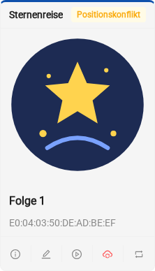

Öffne den Bearbeiten-Dialog des Tonies. Unter *Globales Fortsetzen* stehen
beide Stände mit Box, gehörter Zeit und Zeitpunkt der Meldung. **Diesen Stand
nehmen** wählt einen:

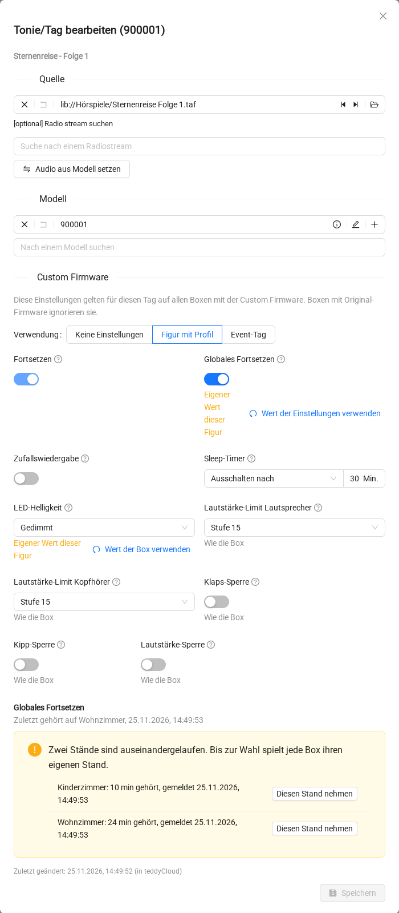

- **Bis zur Wahl** spielt jede der beiden Boxen ihren eigenen Stand. Eine
  dritte Box nimmt ihren eigenen letzten Stand; hat sie keinen, beginnt sie
  von vorn.
- **Nach der Wahl** setzen alle Boxen beim nächsten Auflegen am gewählten
  Stand fort. Spielt eine Box danach noch ihren alten Stand weiter, zum
  Beispiel weil sie weiter offline ist, entsteht ein neuer Konflikt.
- Meldet der Dialog *Die Stände haben sich inzwischen geändert*, hat eine Box
  in der Zwischenzeit neu gemeldet. Prüfe die Stände dann noch einmal.

## 10. Fernbedienung

Das Regler-Symbol auf der Karte einer verbundenen Box öffnet die
Fernbedienung:

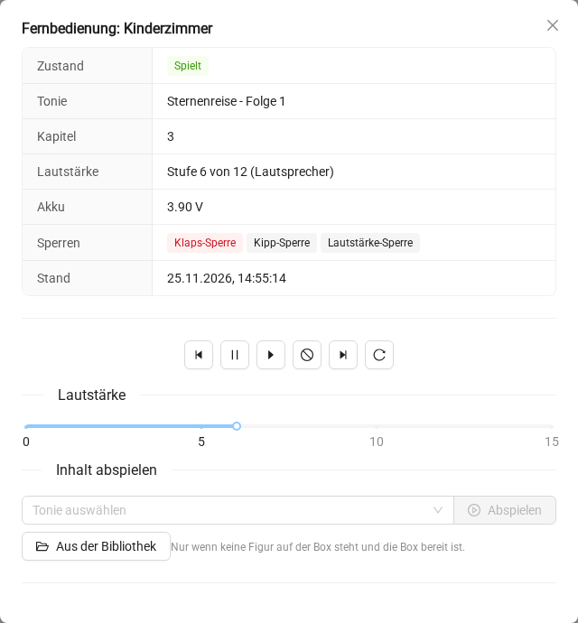

- **Zustand** der Box, Tonie, Kapitel, Lautstärke, Akku und Sperren, live
  aktualisiert.
- **Knöpfe:** voriges Kapitel, Pause, weiter, Stopp, nächstes Kapitel und
  Status abfragen.
- **Lautstärke**-Regler.
- **Inhalt abspielen:** einen Tonie wählen und seinen Inhalt ohne die Figur
  abspielen, oder **Aus der Bibliothek**: jede TAF oder Playlist der
  Bibliothek. Beides geht nur, wenn die Box bereit ist und keine Figur
  aufliegt. So gestartete Inhalte sind als *aus der Ferne* markiert.

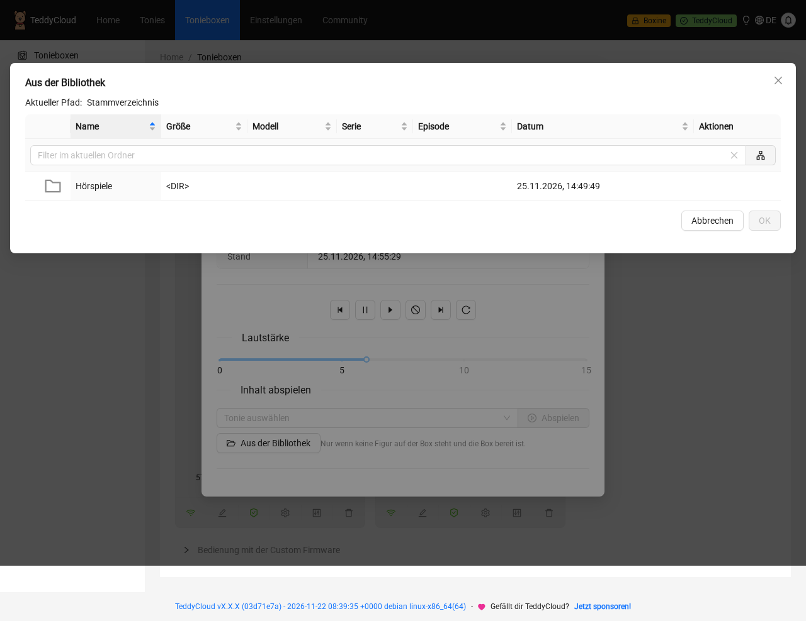

Im Pausenzustand gilt die Box als untätig und schaltet nach ihrer
Ausschaltzeit aus; mit Fortsetzen spielt sie später an der Pausenstelle
weiter. Über MQTT gibt es dieselben Funktionen auch in Home Assistant.

## 11. Box Update

**Tonieboxen → Box Update** verwaltet die Firmware-Images und legt fest,
welche Box welches bekommt.

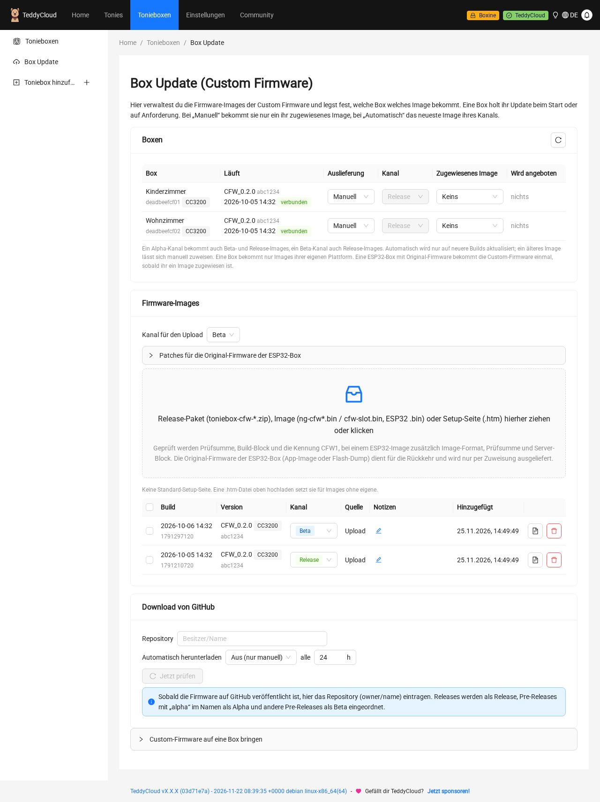

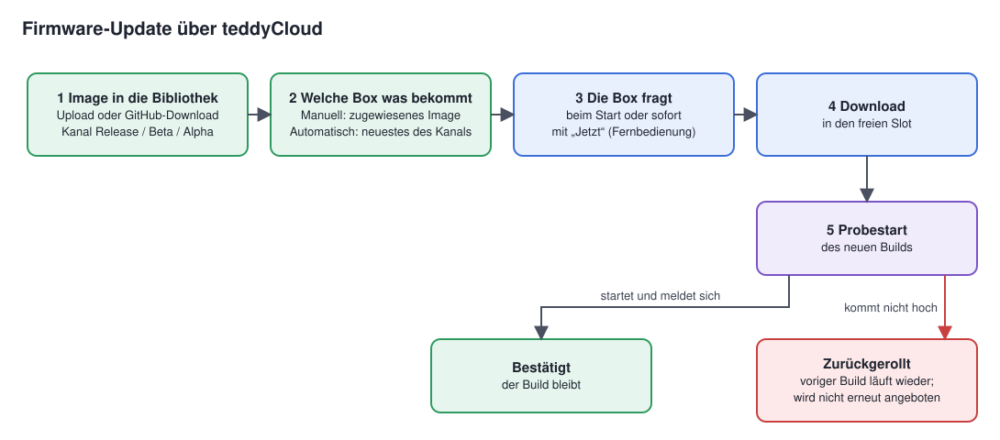

**Boxen.** Eine Zeile je Box: der laufende Build, Auslieferung, Kanal,
zugewiesenes Image und was ihr als Nächstes angeboten wird.

- **Manuell** (Vorgabe): Eine Box bekommt nur ein Image, das du ihr zuweist.
  So geht es auch zurück zu einem älteren Build.
- **Automatisch:** Eine Box bekommt das neueste Image ihres Kanals. Ein
  Alpha-Kanal bekommt auch Beta- und Release-Images, ein Beta-Kanal auch
  Release-Images. Es geht nur zu neueren Builds.
- **Jetzt** lässt eine verbundene Box sofort prüfen; sonst prüft sie beim
  nächsten Start.

**Firmware-Images.** Zieh ein Release-Paket, ein einzelnes Image
(`ng-cfw*.bin`, ESP32-`.bin`) oder eine Setup-Seite (`.htm`) auf das
Upload-Feld. teddyCloud prüft jedes Image (Prüfsumme, Kennung der Custom-Firmware) und
erkennt seine Plattform.
Jedes Image hat einen Kanal (Release, Beta, Alpha), Notizen und eventuell eine
eigene Setup-Seite; *Setup-Seite … neu* markiert ein Paket, dessen Seite sich
von der vorigen unterscheidet.

**Download von GitHub.** Trag das Repository ein (Besitzer/Name). Releases
zählen als Release, Pre-Releases mit „alpha“ im Namen als Alpha, andere
Pre-Releases als Beta. teddyCloud kann sie in einem Intervall automatisch
laden.

**Sichere Updates.** Die Box schreibt einen neuen Build in ihren freien Slot
und startet ihn einmal zur Probe. Kommt er nicht sauber hoch, geht der
Bootloader von selbst zum vorigen Build zurück; teddyCloud zeigt *Build …
wurde zurückgerollt* und bietet diesen Build dieser Box nicht noch einmal an.

## 12. Gesten an der Box

Diese gehen auf jeder CFW-Box, unabhängig von den Einstellungen:

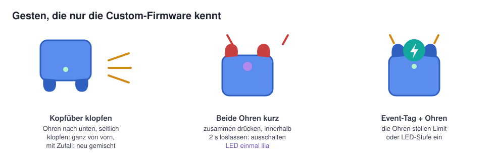

- **Kopfüber klopfen:** Box umdrehen (Ohren nach unten) und seitlich klopfen.
  Ohne Zufallswiedergabe springt die Wiedergabe an den Anfang des Tonies.
  Mit Zufallswiedergabe mischt die Box neu und beginnt die neue Reihenfolge
  von vorn, auch mit Fortsetzen. Die Klaps-Sperre sperrt auch das.
- **Beide Ohren kurz:** beide Ohren zusammen drücken und innerhalb von 2
  Sekunden loslassen. Die LED blinkt einmal lila, die Position bleibt
  gespeichert und die Box schaltet aus, auch mit aufgelegtem Tonie. Längeres
  Halten wirkt wie im Original (Einrichtungsmodus nach 5 s, kopfüber Neustart
  nach 10 s). Pro Box abschaltbar.
- **Jeder NFC-Tag als Tonie** ([Kapitel 7](#7-tonie-einstellungen)).

## 13. Zurück zur Original-Firmware

- **CC3200:** In `/revvox/boot/ngCfg.json` unter `general` `"activeImg"` auf
  den vorigen Wert setzen (meist `"ofw1"`) und die Zeile `"stateFile"`
  löschen. Solange `stateFile` dort steht, startet der Bootloader den Slot aus
  der Boot-Zustandsdatei. Die Original-Firmware im Flash wurde nie verändert.
- **ESP32:** der Box das Image der Original-Firmware zuweisen (den
  Flash-Dump, den du in die Bibliothek geladen hast). Sie installiert es bei
  ihrer nächsten Update-Prüfung.

## 14. Fragen und Probleme

**Die Box ist nicht als CFW markiert.** Prüfe, ob die CFW-Unterstützung an ist und
die Box seitdem gestartet wurde. Eine Box zählt nur mit dem Header, den die
Custom-Firmware sendet, als CFW; eine Box, die auf die Original-Firmware
zurückgefallen ist, steht als *Original-Firmware / unbekannt* da.

**Eine Einstellung kommt nicht an.** Die Box holt Einstellungen beim
Freshness-Check: einen Tonie auflegen oder die Box neu starten. Werte der Box
zählen nur mit angehaktem **überschreiben**.

**Die Fernbedienung ist ausgegraut.** Die Box muss verbunden sein
(Log-Verbindung) und die Fernbedienung in den Einstellungen erlaubt.

**Ein Update wird nicht angeboten.** Bei *Manuell* ein Image zuweisen. Bei
*Automatisch* gibt es nur neuere Builds des Kanals, und ein zurückgerollter
Build wird derselben Box nicht noch einmal angeboten.

**Der Browser-Weg für CC3200 fehlt.** Er braucht Chrome oder Edge am Rechner
und teddyCloud über HTTPS.
