# Custom firmware: user manual

[Deutsch](de.md) · English

This manual shows how to use the custom firmware (CFW) of the Toniebox with
teddyCloud's web interface: switching the support on, getting the
firmware onto a box, and every function it adds. The pictures come from a
test installation with a simulated box; names and values are examples.

The custom firmware is in testing. Changing the firmware of a box is at your
own risk (see "Legal" in the [README](../../README.md#legal)).

## Contents

1. [How the parts work together](#1-how-the-parts-work-together)
2. [Switch on the CFW support](#2-switch-on-the-cfw-support)
3. [Getting the custom firmware onto a box](#3-getting-the-custom-firmware-onto-a-box)
4. [The setup page of the box](#4-the-setup-page-of-the-box)
5. [The box in teddyCloud](#5-the-box-in-teddycloud)
6. [Box settings](#6-box-settings)
7. [Tonie settings](#7-tonie-settings)
8. [Event tags](#8-event-tags)
9. [Global resume](#9-global-resume)
10. [Remote control](#10-remote-control)
11. [Box update](#11-box-update)
12. [Gestures on the box](#12-gestures-on-the-box)
13. [Back to the original firmware](#13-back-to-the-original-firmware)
14. [Questions and problems](#14-questions-and-problems)

## 1. How the parts work together

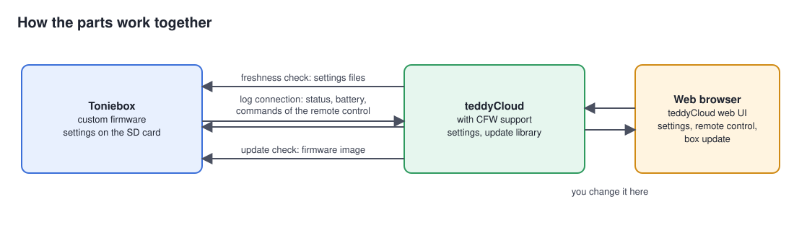

- **teddyCloud with CFW support** keeps the settings of your boxes and tonies,
  the firmware library and the state each box reports.
- **The box** fetches its settings with its usual freshness check and keeps
  them on the SD card, so they work without a network too. A second
  connection (the log connection) carries status, battery and the commands of
  the remote control.
- **You** change everything in the web UI. A box without any CFW
  settings behaves like the original firmware, except for the gestures of
  [chapter 12](#12-gestures-on-the-box).

Towards teddyCloud and the Boxine cloud the box presents itself as the
original firmware, so it also works with a teddyCloud without CFW
support; only the functions of this manual are missing then.

## 2. Switch on the CFW support

The CFW support is off by default; without it teddyCloud behaves exactly as
without CFW support. Open **Tonieboxes → Box update** and click **Switch on
CFW support**:

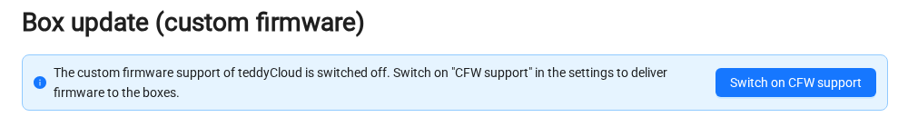

The general CFW options are under **Settings**, section **Custom firmware**
(some only at settings level *Detail* or *Expert*):

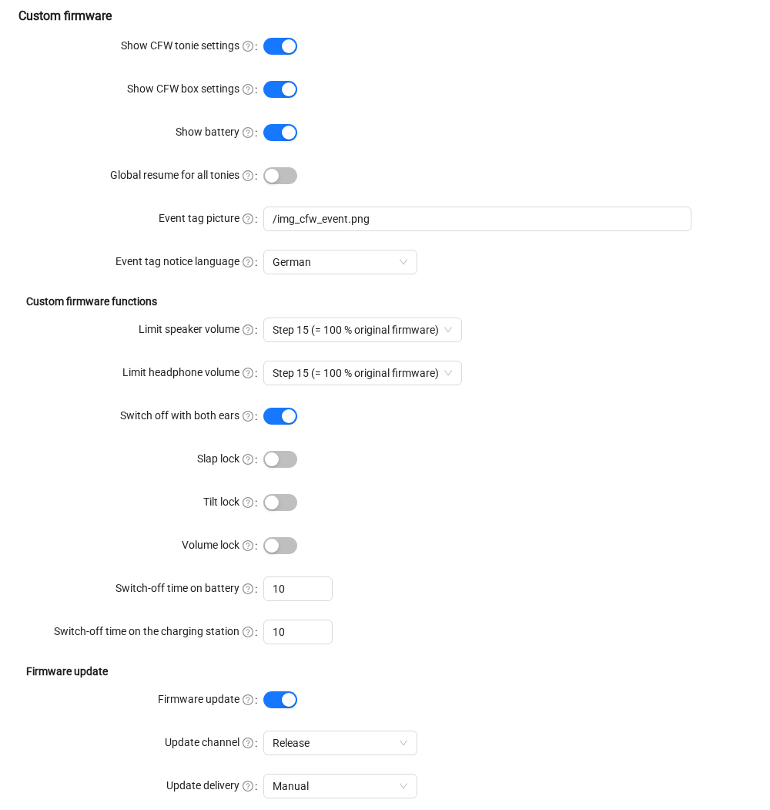

| Option | Meaning |
| --- | --- |
| Show CFW tonie settings | Shows the *Custom firmware* part in a tonie's edit dialog. Switched on by itself when the first CFW box reports. |
| Show CFW box settings | Shows the *Custom firmware* part in the box settings. |
| Show battery | Battery state on the box card. |
| Global resume for all tonies | Every tonie without own settings continues across boxes ([chapter 9](#9-global-resume)). |
| Event tag picture, event notice language | Picture of event tags in the lists, and the language of the notice that a box with the original firmware plays for an event tag. |
| Custom firmware functions | The defaults of all boxes: volume limits, switch-off with both ears, the three locks, the switch-off times on battery and on the charging station. Each box can override them ([chapter 6](#6-box-settings)). |
| Firmware update | Update on or off, channel and delivery for all boxes ([chapter 11](#11-box-update)). |

## 3. Getting the custom firmware onto a box

The way depends on two things: which chip the box has (**Tonieboxes → Add
Toniebox → Identify version**) and whether it is still fully original or
runs with teddyCloud already.

| | Box still original | Box runs with teddyCloud already |
| --- | --- | --- |
| **CC3200** | open the box and flash it, in the browser or on the command line, then prepare the SD card | prepare the SD card only |
| **ESP32** | open the box and flash it with the ESP32 flasher, custom firmware included | through teddyCloud, without opening the box |

For every way, first:

1. Switch on the CFW support ([chapter 2](#2-switch-on-the-cfw-support)).
2. Load the release package `toniebox-cfw-….zip` into the library of **Box
   update**, by upload or download from GitHub ([chapter 11](#11-box-update)).
   The flashers and the SD card zip take the firmware from there.

**Box update → Getting the custom firmware onto a box** shows the steps for a
box that runs with teddyCloud already, with your server's address filled in.

### Box with CC3200 chip

The CC3200 box starts the custom firmware from the SD card. The original
firmware stays unchanged in the flash and can be started again at any time
([chapter 13](#13-back-to-the-original-firmware)).

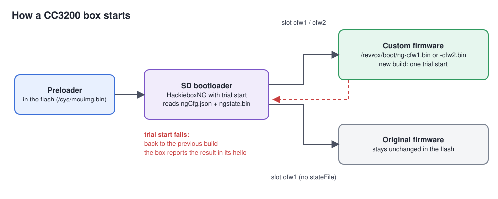

**Box still original.** Open the box and choose under **Add Toniebox →
CC3200**:

- **In the browser** (Chrome or Edge on a computer, teddyCloud opened over
  HTTPS; connected through a UART adapter or an ESP32-C3): the page backs up
  the flash, reads the box's certificates, replaces the CA certificate by
  teddyCloud's and installs the bootloader, all over the serial port. Then it
  offers the finished content of the SD card for download: bootloader, custom
  firmware, setup page and your server. Unpack it into the root of the card.
- **Command line:** the same steps with the tools of HackieboxNG; then
  prepare the SD card as in the next paragraph.

Keep the flash backup in a safe place.

**Box runs with teddyCloud already** (the HackieboxNG bootloader is
installed, teddyCloud's certificate is in the flash): the SD card is enough.
**Add Toniebox → CC3200 → SD card only** makes the whole content of the card
as a zip from the release package; unpack it into the root of the card.

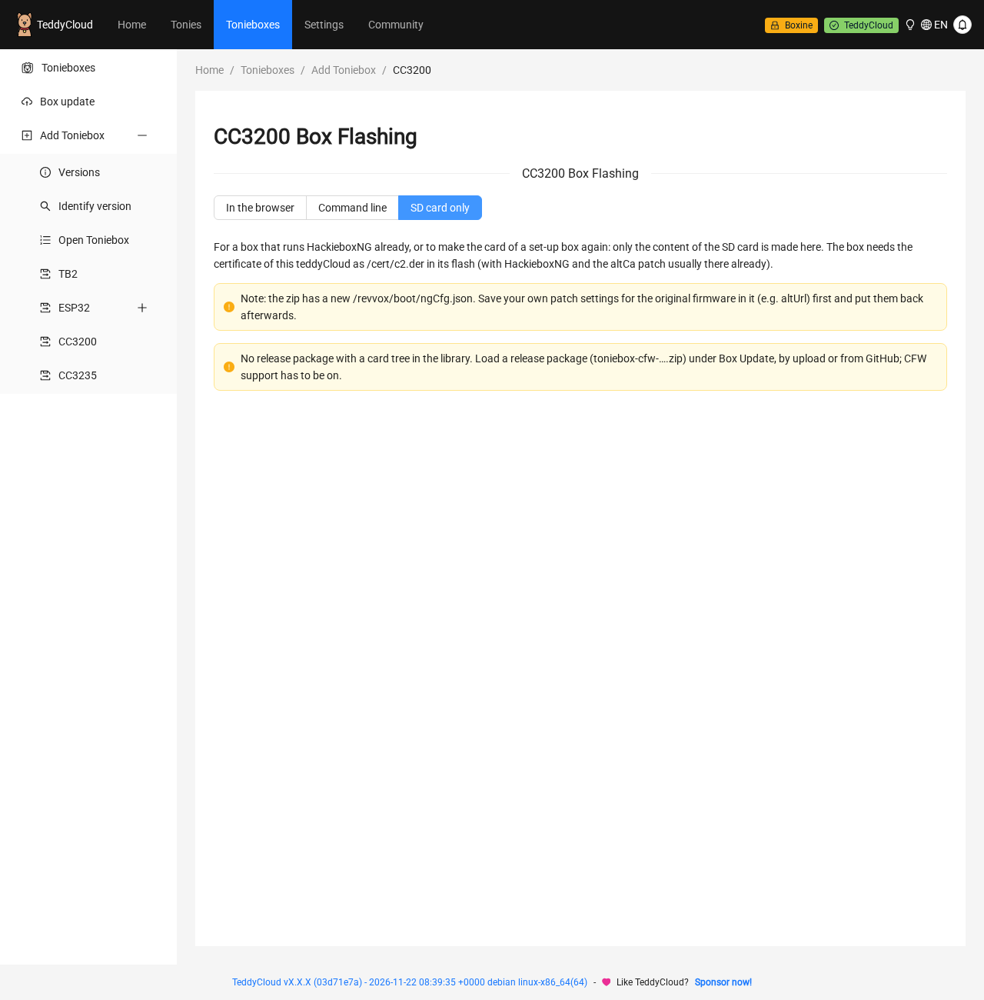

The zip holds a new `/revvox/boot/ngCfg.json`. If you made your own patch
settings for the original firmware there (for example `altUrl`), save them
first and put them back afterwards.

By hand, the steps are:

1. Copy the contents of `cc3200/card/` of the package into the root of the
   card. It holds the bootloader with trial start and automatic return, the
   firmware as `/revvox/boot/ng-cfw1.bin`, the boot state file
   `/revvox/boot/ngstate.bin`, the `ngCfg.json` with `"activeImg": "cfw1"`
   and `"stateFile"`, and the setup page `/cfw/setup.htm`.
2. Write the server into `/cfw/config.txt`: `host=<your teddyCloud>` and, if
   needed, `port=`.
3. Put the card back and start the box. It reports to teddyCloud and appears
   under **Tonieboxes** marked *CFW*.

### Box with ESP32 chip

The ESP32 box has two firmware slots in its flash. The custom firmware goes
into the free one; the original firmware stays in the other.

**Box still original.** Open the box and flash it under **Add Toniebox →
ESP32** (Chrome, Edge or Firefox from version 151, teddyCloud over HTTPS).
The flasher backs up the whole flash first. In the step **Flash**, choose
**Custom firmware** instead of "Original firmware (patched for teddyCloud)".
The custom firmware starts right after flashing.

- If it does not confirm itself three times in a row, the box starts the
  original firmware again.
- Keep the flash dump in a safe place and load it into the library of **Box
  update**. With it the box can go back to the original firmware later
  without being opened.

**Box runs with teddyCloud already** (the original firmware patched for
teddyCloud): the box gets the custom firmware through teddyCloud and need
not be opened.

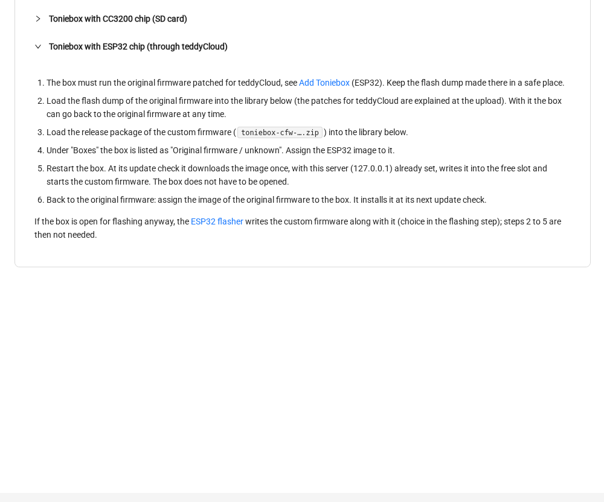

1. Load the flash dump from flashing the box into the library of **Box
   update**. With it the box can go back to the original firmware at any
   time.
2. Under **Boxes** the box shows as *Original firmware / unknown*. Assign it
   the ESP32 image of the release package.
3. Restart the box. At its update check it downloads the image once, with
   your server already filled in, writes it into its free slot and starts the
   custom firmware.

## 4. The setup page of the box

The custom firmware brings its own setup page. Hold both ears for 5 seconds
to put the box into setup mode, then connect to the box's Wi-Fi as for the
original setup and open the page.

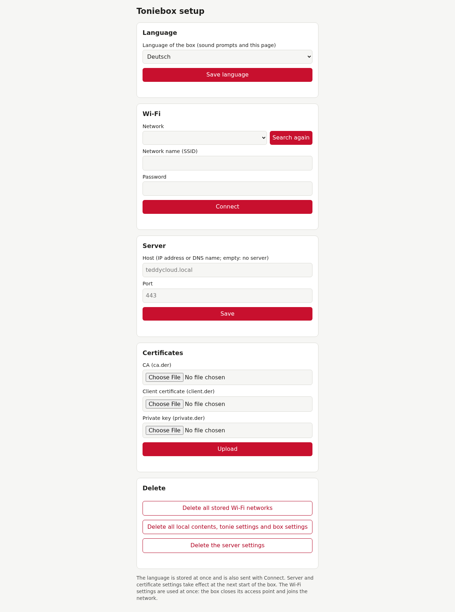

- **Language** of the box's sound prompts and of this page.
- **Wi-Fi:** choose a network from the scan list or type its name.
- **Server:** host and port of your teddyCloud (empty host: no server).
- **Certificates:** upload `ca.der`, `client.der` and `private.der`.
- **Delete:** all stored Wi-Fi networks, all local contents with tonie and
  box settings, or the server settings. These replace the factory reset of
  the original firmware.

teddyCloud keeps the page up to date: a release package brings its page, and a
box gets a newer one at its next start ([chapter 11](#11-box-update)).

### Directly on the SD card

Without the setup page, some things can also be changed directly on the SD
card: switch the box off, put the card into the computer, change it, put the
card back, start the box.

**Server:** `/cfw/config.txt` is a text file with one setting per line; lines
with `#` are comments. The box reads it at every start.

| Line | Meaning |
| --- | --- |
| `host=…` | name or IP address of your teddyCloud |
| `port=…` | port; without the line 443 |
| `ca=…` | CC3200 only: name of the CA file in the flash; without the line `ca.der`. For boxes with the alternative CA patch of HackieboxNG `ca=c2.der` |

If the file is missing or `host` is invalid, the box connects to no server.
Content already on the card plays all the same.

**Certificates (CC3200 only):** put `ca.der`, `client.der` and/or
`private.der` into the folder `/cfw/cert/`. At the next start the box writes
them into its flash and then deletes them from the card, so that the private
key does not stay there. A file that is not a valid certificate stays on the
card and changes nothing. The original firmware uses the same certificates.
On the ESP32 box, certificates go through the setup page only; the original
firmware's certificates stay unchanged.

**Tonie and box settings** are under `/cfw/ext/`. These are binary files with
a checksum that teddyCloud writes; they cannot be edited by hand. Change them
in teddyCloud.

## 5. The box in teddyCloud

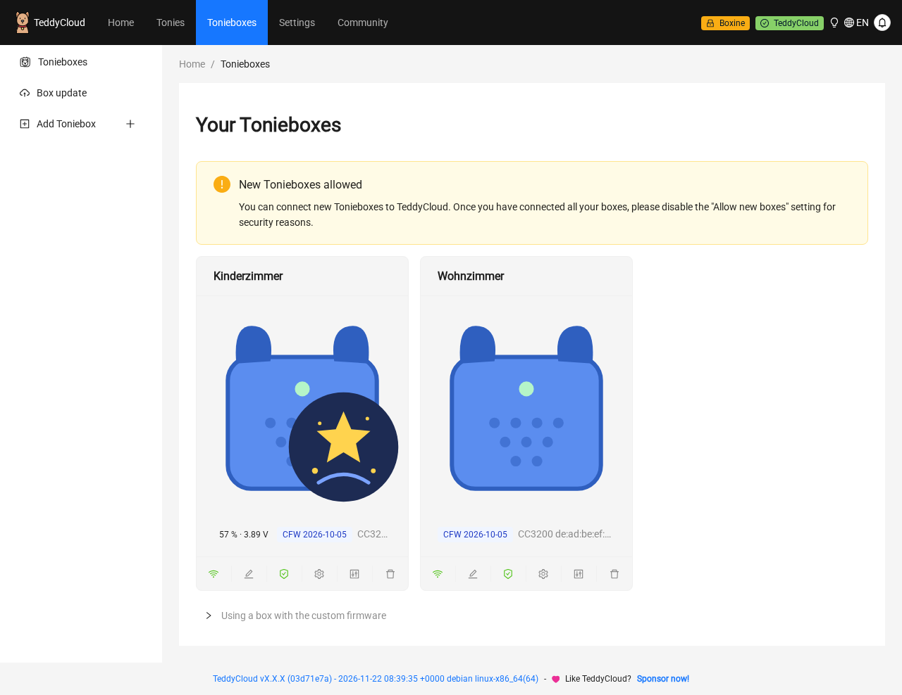

The card of a CFW box shows:

- the **battery**: percent and voltage. The percentage counts the running
  time since the last charge and learns the capacity of the cell; the
  tooltip gives the running time left and when the box last reported.
- the **CFW** mark with the build date (tooltip: the build number).
- the **remote control** button (slider icon, [chapter 10](#10-remote-control)).

**Using a box with the custom firmware** below the cards opens a short
summary of the gestures and functions:

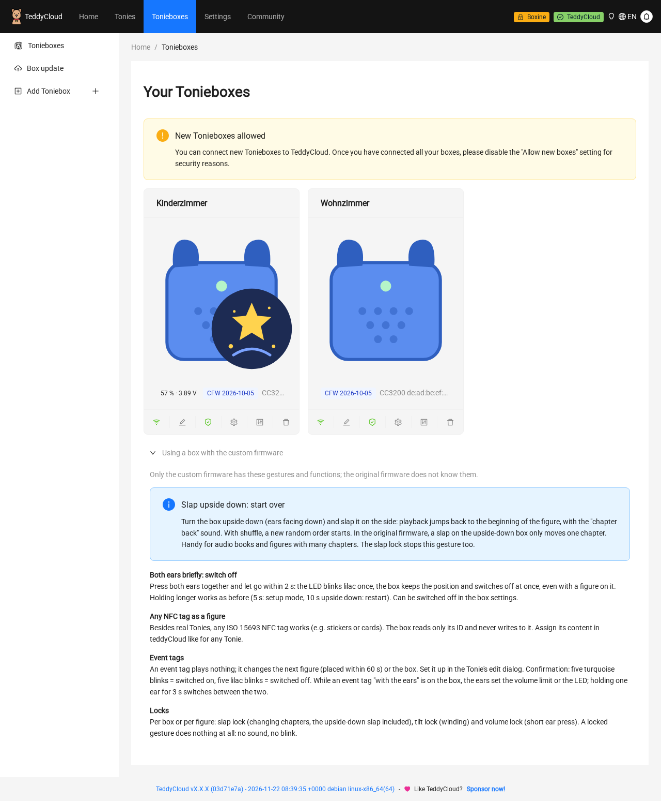

## 6. Box settings

The gear icon of the card opens the box's settings. With the CFW support on,
they contain a **Custom firmware** part:

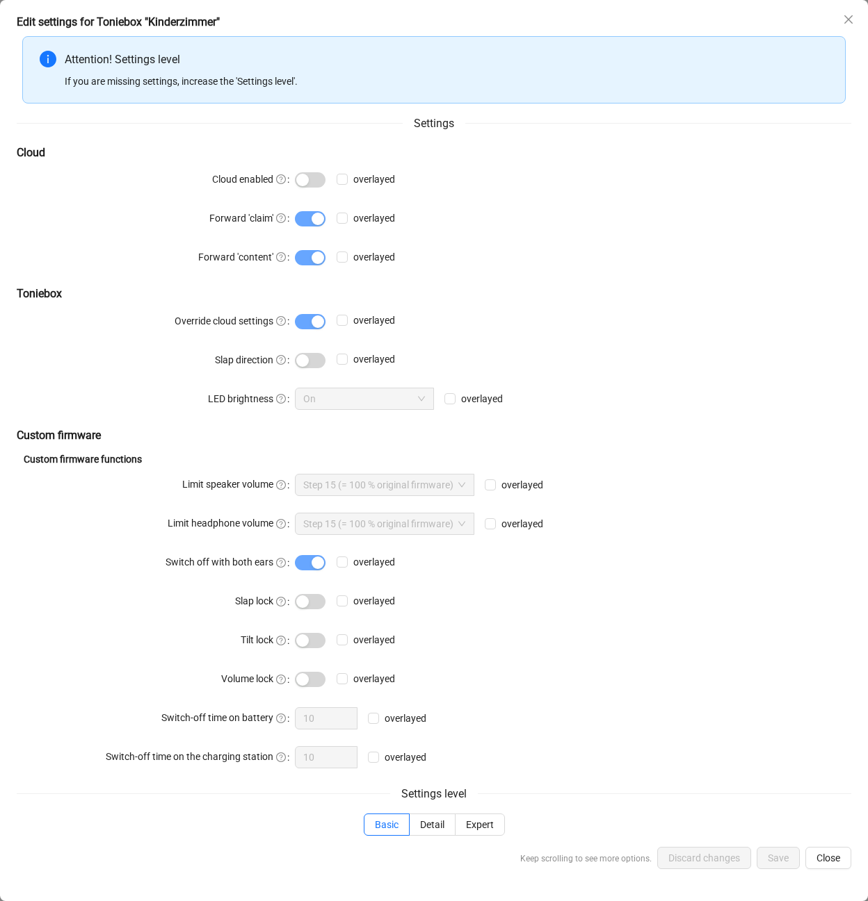

A box value only counts when **override** next to it is ticked; otherwise the
box takes the value of the general settings ([chapter 2](#2-switch-on-the-cfw-support)).

| Setting | Effect |
| --- | --- |
| Speaker / headphone volume limit | Highest volume in all 16 steps (0 to 15). The original only knows 4 levels. |
| Switch off with both ears | Press both ears briefly: the box switches off ([chapter 12](#12-gestures-on-the-box)). |
| Slap lock | Slapping no longer changes the chapter (the upside-down slap neither). |
| Tilt lock | Tilting no longer winds forward or back. |
| Volume lock | A short ear press no longer changes the volume; holding an ear and the gestures with both ears still work. |
| Switch-off time on battery / on the charging station | Minutes without playback until the box switches itself off (1 to 65535; default 10 as in the original). |

**LED brightness** is in the *Toniebox* part of the same settings. It applies
while the box is ready:

| Value | Effect |
| --- | --- |
| On | The LED shines bright. |
| Dimmed | After the bright phase (3 seconds bright, 2 seconds fading) the LED shines faintly; every action makes it bright again. |
| Off | As dimmed, but the LED goes off after the bright phase. |
| Dimmed permanently | Custom firmware only: the LED is faint at once, without the bright phase, also on every action. All other displays are dimmed too, the blinking while a content loads included. |
| Off permanently | Custom firmware only: the LED is off at once, without the bright phase, also on every action. All other displays are dimmed, and the blinking while a content loads is left out. |

Boxes with the original firmware get "Dimmed" or "Off" instead of the
permanent values.

A locked gesture does nothing at all: no sound, no blink. Settings changed on
the box itself (by an event tag or with the ears) come back to teddyCloud and
show up here.

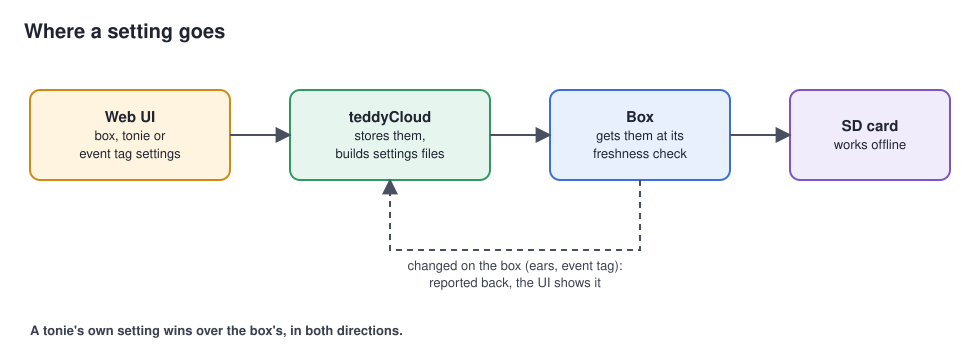

## 7. Tonie settings

Open **Tonies**, click the pencil of a tonie (or any NFC tag) and choose
**Use: Figure with profile** in the *Custom firmware* part:

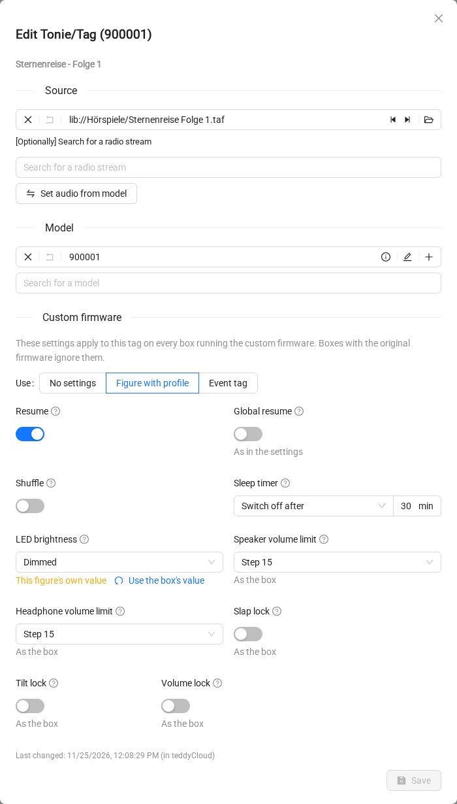

| Setting | Effect |
| --- | --- |
| Resume | The tonie continues where it stopped, even when other tonies played in between or the box was off. At the end of the content it starts from the beginning next time. |
| Global resume | Continues across boxes ([chapter 9](#9-global-resume)). Includes resume. |
| Shuffle | Contents with 2 to 99 chapters play every chapter once in a random order; slapping moves through this order. See below. |
| Sleep timer | Switch off after N minutes. During the first third the volume stays, then it fades to silence. Taking the tonie off pauses the timer. |
| LED brightness | One of the five values of [chapter 6](#6-box-settings) while this tonie is on the box. |
| Volume limits | Own limits for speaker and headphones; may be higher than the box's. |
| Slap, tilt and volume lock | Only for this tonie. |

**Shuffle, resume and the upside-down slap.** When the box shuffles anew:

| | The same tonie placed again | Another tonie played in between |
| --- | --- | --- |
| Shuffle without resume | continues at the same point of the same order | shuffled anew, from the start |
| Shuffle with resume | continues at the same point of the same order | continues at the same point of the same order, also after switch-off |

After the last chapter of the order, playback ends; the next placement
shuffles anew. **Slapping upside down** ([chapter 12](#12-gestures-on-the-box))
shuffles anew at any time and starts the new order from the beginning.

Every value can say **As the box**: then the box's setting applies. A value of
the tonie wins over the box's in both directions. The settings apply to this
tag on every CFW box; boxes with the original firmware ignore them.

Any ISO 15693 NFC tag (stickers, cards) works like a tonie: the box only reads
its ID and never writes to it.

## 8. Event tags

An event tag plays nothing. When you place it, the box changes settings,
without teddyCloud: for example a sleep timer for the next tonie, or the
box's volume and LED in the evening. Any spare tonie, Creative Tonie or NFC
sticker can be an event tag.

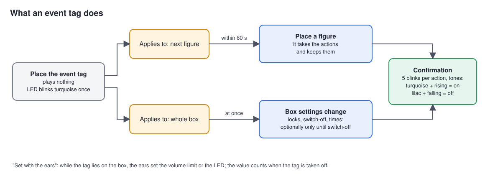

### Setting one up

1. Open **Tonies** and click the pencil of the tag.
2. In the *Custom firmware* part, choose **Use: Event tag**.
3. Under **Applies to**, choose what the tag changes:
   - **Next figure:** the settings of the tonie you place afterwards.
   - **Whole box:** the settings of the box.
4. Add the actions with **Add action**. Each has a mode and, where needed, a
   value (tables below).
5. Choose whether there are **Feedback tones** and, for *Whole box*, whether
   the change holds **Only until switch-off**. Then **Save**.

The box gets the tag at its next freshness check (place a tonie or restart
the box).

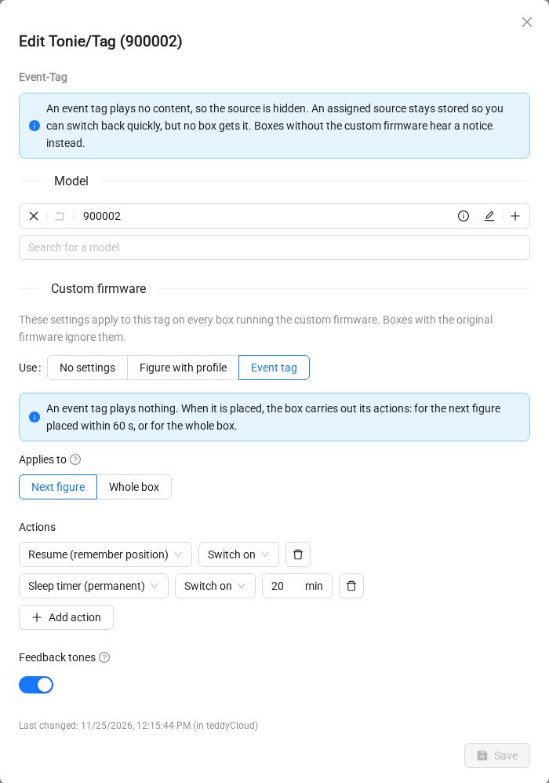

### The modes

| Mode | Effect |
| --- | --- |
| Switch on / Switch off | sets the value to on or off |
| Toggle | turns the value in effect round: on becomes off, off becomes on |
| Remove | deletes the own value; the default applies again (for a tonie: "As the box") |
| Set with the ears | while the tag is on the box, you set the value with the ears (see below) |

### Applies to: next figure

Place the event tag and take it off again. Then the actions wait 60 seconds
for the next tonie. It takes them into its settings and keeps them until they
are changed again. If no tonie comes within the 60 seconds, they lapse
without a sign.

| Action | Modes | Value |
| --- | --- | --- |
| Resume, shuffle | toggle, switch on, switch off, remove | – |
| Slap, tilt, volume lock of the figure | toggle, switch on, switch off, remove | – |
| Sleep timer (permanent) | toggle, switch on, switch off, remove | minutes |
| Sleep timer (once) | – | minutes; holds for this tonie until the time is up, another tonie is placed or the box goes off (taking it off only pauses it); the tonie's settings stay |
| Volume limit of the figure | set with the ears, remove | start value |
| LED brightness of the figure | set with the ears, remove | start value |
| Reset the figure's profile | – | deletes all settings of the tonie |

### Applies to: whole box

The actions change the box's settings. Locks, the switch-off with both ears
and the switch-off times change at once when the tag is placed. Volume limit
and LED set with the ears count when the tag is taken off. teddyCloud takes
the new values over and shows them in the box settings ([chapter 6](#6-box-settings)).

| Action | Modes | Value |
| --- | --- | --- |
| Slap, tilt, volume lock of the box | toggle, switch on, switch off, remove | – |
| Switch off with both ears | toggle, switch on, switch off, remove | – |
| Switch-off time on battery / on the charging station | – | minutes; 0 removes the value (then 10 minutes as in the original) |
| Volume limit of the box | set with the ears, remove | start value |
| LED brightness of the box | set with the ears, remove | start value |
| Sleep timer (once, for the next figure) | – | minutes; waits 60 seconds for the next tonie, as above |

### Only until switch-off

This switch exists for *Whole box*. When it is on, the tag's changes hold
only until the box goes off (a restart included). The box stores nothing and
reports nothing to teddyCloud; afterwards the stored settings apply again. If
the same setting changes for good in the meantime, the temporary value ends.

Example: an "evening tag" that locks slapping for tonight and lets you set
the volume limit and the LED with the ears. The next morning everything is as
before.

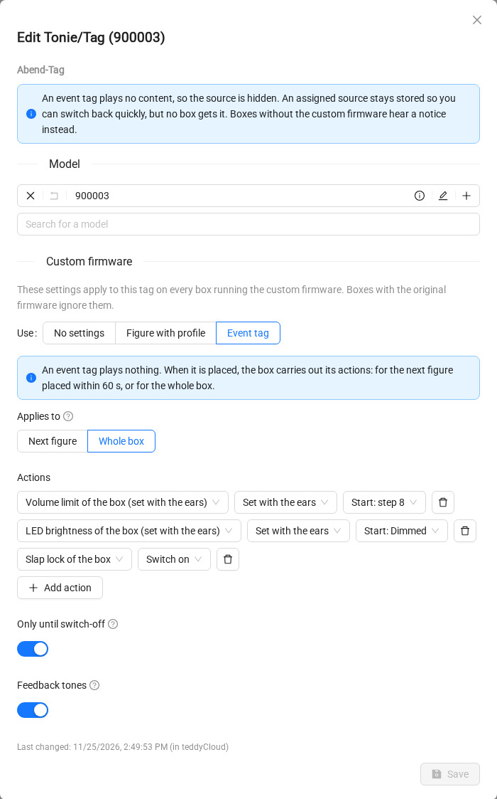

### Setting the volume limit with the ears

1. Place the tag. The volume limit of both outputs is fully open now (step 15), and
   the volume jumps to the **start value**: *current volume* leaves it as it
   is; *step N* sets it to N.
2. Set the volume that is to become the new volume limit with the ears.
3. Take the tag off. The volume set becomes the volume limit, for the output that is
   in use: speaker or headphones.

The volume lock does not act on these presses.

### Setting the LED brightness with the ears

1. Place the tag. The LED shows the **start value**: *current brightness* or
   the level chosen.
2. Each press of an ear goes one level on, through all five levels of the
   box settings:

   | Level | Turquoise blinks | then |
   | --- | --- | --- |
   | On | 1× | bright |
   | Dimmed | 2× | briefly bright, then dimmed |
   | Off | 3× | dark |
   | Dimmed permanently | 4× | dimmed |
   | Off permanently | 5× | dark |

   After "Off permanently", "On" comes again. Each display lasts 5
   seconds.
3. Take the tag off. The level shown applies.

**Both on one tag:** the ears set the volume first. Holding one ear for 3
seconds switches to the LED (the level is shown), holding again switches back
to the volume (one turquoise blink). When the tag is taken off, both values
apply.

### Confirmation

When the box has carried out the actions, it confirms once for all of them:

| Result | LED (5 seconds) | Tones per action |
| --- | --- | --- |
| all switched on | five turquoise blinks | rising |
| all switched off | five lilac blinks | falling |
| mixed | turquoise and lilac in turn | rising or falling per action |

**Feedback tones** off switches the tones off for this tag; the blinks stay.
A tag for the next figure shows a short turquoise blink when it is placed:
it has been taken.

A box with the original firmware plays a short notice for an event tag
instead (language in the settings).

## 9. Global resume

A tonie with **Global resume** continues on any CFW box where it stopped on
another one, like a cassette. Each box reports the position to teddyCloud and
asks for the latest one when the tonie is placed. Content the box does not
have yet is downloaded first.

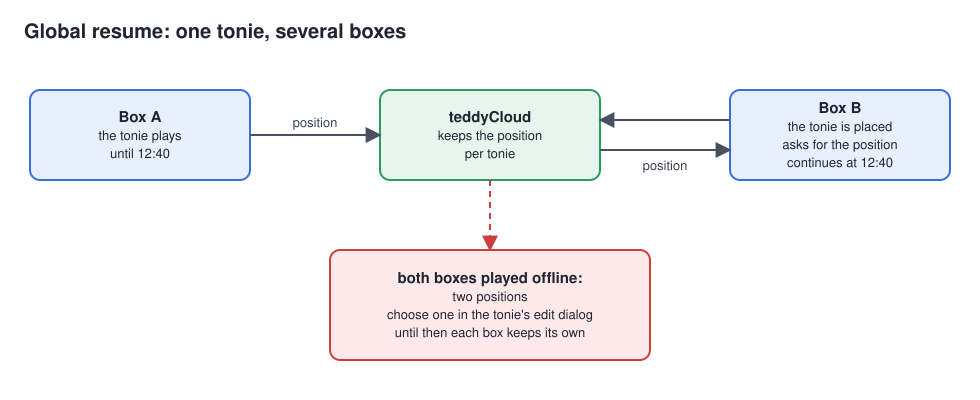

It is switched on per tonie ([chapter 7](#7-tonie-settings)), or with
**Global resume for all tonies** in the settings for every tonie without own
settings (live content and streams left out). The tonie's edit dialog shows
where it was heard last and on which box it plays now. It also names boxes
whose firmware cannot do global resume yet.

### What it costs

Global resume needs teddyCloud each time the tonie is placed. That has its
price:

- **Waiting before playback.** The box plays only once teddyCloud has named
  the position. When the box is connected, this takes up to 3 seconds. Just
  after switching on, or while the connection to teddyCloud is being set up
  again, it waits up to 20 seconds. Meanwhile the LED blinks blue.
- **Waiting for the content.** When the content is not complete on the card
  and playback does not start from the beginning, the box first downloads it
  up to the place where it goes on. With a place far into the content and
  slow Wi-Fi this can take much longer.
- **Without teddyCloud** (no Wi-Fi, offline mode, server off) the box does
  not wait and continues at its own last position. If the tonie has played
  on another box in the meantime, a conflict arises later (next section).
- **Other content.** When the tonie's content has changed, it starts from the
  beginning.

For tonies that always play on the same box, the normal **Resume** is
therefore enough.

### When two positions go apart

When the tonie plays on different boxes one after the other, teddyCloud just
hands the position on. A conflict only arises when two boxes played on from
the same position without teddyCloud learning of it in between. That happens
when a box was offline.

Example: the tonie stands at minute 0:30. In the children's room it plays
without internet up to minute 10, in the living room up to minute 24. Both
boxes report their position as soon as they are connected again. teddyCloud
silently overwrites neither:

- **Small difference:** if one of the boxes heard less than 30 seconds, the
  other box's position applies, without asking.
- **Otherwise a conflict:** the tonie's card under **Tonies** is marked
  *Position conflict*. A message goes to Home Assistant through MQTT.

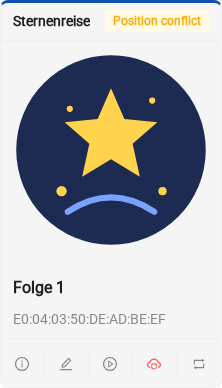

Open the tonie's edit dialog. Under *Global resume* both positions are listed
with the box, the time heard and when they were reported. **Take this
position** chooses one:

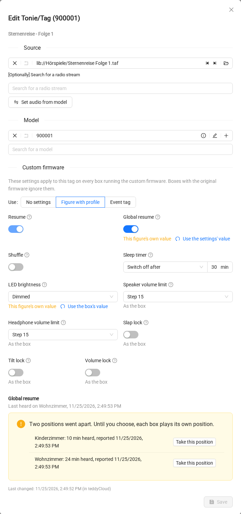

- **Until you choose**, each of the two boxes plays its own position. A third
  box takes its own last position; without one, it starts from the
  beginning.
- **After the choice**, every box continues at the chosen position the next
  time the tonie is placed. If a box keeps playing its old position after
  that, for example because it is still offline, a new conflict arises.
- If the dialog says *The positions changed in the meantime*, a box has
  reported again. Check the positions once more.

## 10. Remote control

The slider icon on the card of a connected box opens the remote control:

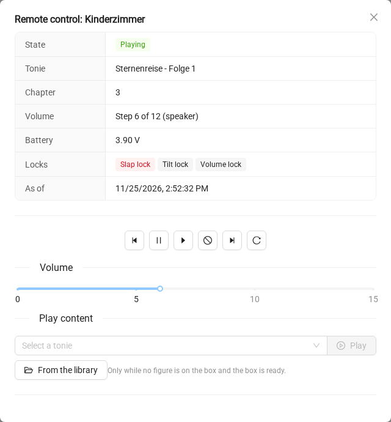

- **State** of the box, the tonie, chapter, volume, battery and locks, updated
  live.
- **Buttons:** previous chapter, pause, continue, stop, next chapter, and
  request status.
- **Volume** slider.
- **Play content:** choose a tonie and play its content without the figure on
  the box, or **From the library**: any TAF or playlist of the library.
  Both need the box to be ready and without a figure on it. A content played
  this way is marked *played remotely*.

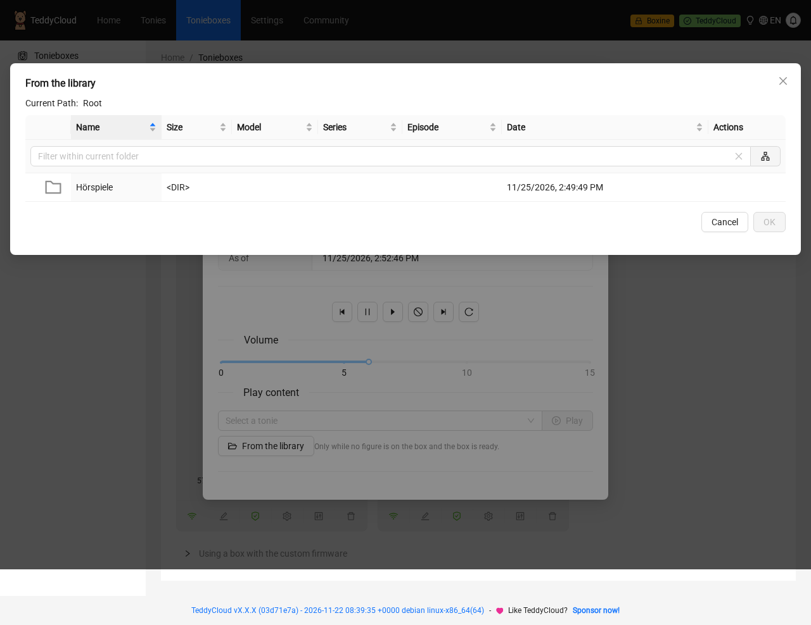

While paused, the box counts as idle and switches off after its switch-off
time; with resume it continues at the paused position later. Through MQTT the
same functions are also available in Home Assistant.

## 11. Box update

**Tonieboxes → Box update** manages the firmware images and decides which box
gets which one.

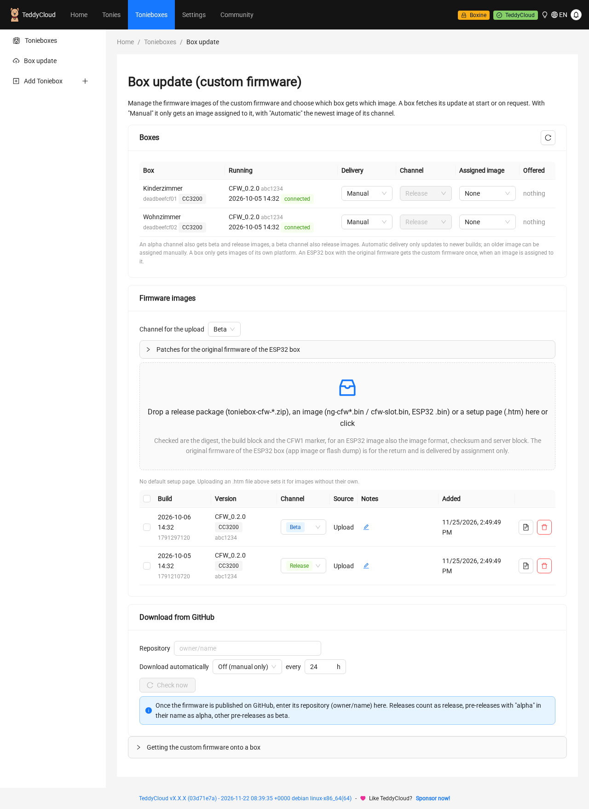

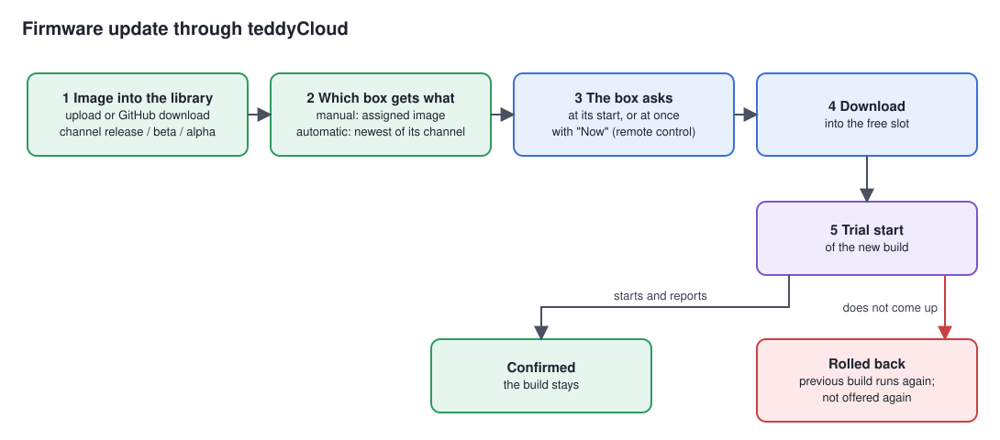

**Boxes.** One row per box: the build it runs, the delivery, channel,
assigned image and what it is offered next.

- **Manual** (default): a box gets only an image you assign to it. This is
  also how you go back to an older build.
- **Automatic:** a box gets the newest image of its channel. An alpha channel
  also gets beta and release images, a beta channel also release images. It
  only updates to newer builds.
- **Now** makes a connected box check at once; otherwise it checks at its
  next start.

**Firmware images.** Drop a release package, a single image (`ng-cfw*.bin`,
ESP32 `.bin`) or a setup page (`.htm`) on the upload field. teddyCloud
checks each image (digest, custom firmware marker) and recognises its
platform. Each image has a channel
(release, beta, alpha), notes and possibly its own setup page; *New setup page …*
marks a package whose page differs from the previous one.

**Download from GitHub.** Enter the repository (owner/name). Releases count as
release, pre-releases with "alpha" in their name as alpha, other pre-releases
as beta. teddyCloud can download them automatically at an interval.

**Safe updates.** The box writes a new build into its free slot and starts it
once as a trial. If it does not come up properly, the bootloader goes back to
the previous build on its own; teddyCloud shows *Build … was rolled back* and
does not offer that build to this box again.

## 12. Gestures on the box

These work on every CFW box, whatever the settings:

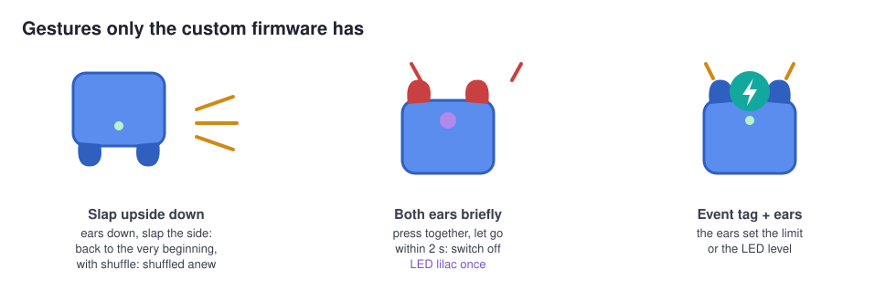

- **Slap upside down:** turn the box over (ears down) and slap its side.
  Without shuffle, playback jumps back to the very beginning of the tonie.
  With shuffle, the box shuffles anew and starts the new order from the
  beginning, also with resume. The slap lock stops this too.
- **Both ears briefly:** press both ears together and let go within 2
  seconds. The LED blinks lilac once, the position is kept and the box
  switches off, even with a tonie on it. Holding longer still works as in the
  original (setup mode after 5 s, restart upside down after 10 s). Can be
  switched off per box.
- **Any NFC tag as a tonie** ([chapter 7](#7-tonie-settings)).

## 13. Back to the original firmware

- **CC3200:** in `/revvox/boot/ngCfg.json`, under `general`, set
  `"activeImg"` back to its previous value (usually `"ofw1"`) and delete the
  line `"stateFile"`. As long as `stateFile` is there, the bootloader starts
  the slot of the boot state file. The original firmware in the flash was
  never changed.
- **ESP32:** assign the image of the original firmware (the flash dump you
  loaded into the library) to the box. It installs it at its next update
  check.

## 14. Questions and problems

**The box is not marked CFW.** Check that the CFW support is on and that the
box has started since. A box counts as CFW only with the header the custom
firmware sends; a box that fell back to the original firmware shows as
*Original firmware / unknown*.

**A setting does not arrive.** The box fetches settings at its freshness
check: put a tonie on it or restart it. Box values only count with
**override** ticked.

**The remote control is greyed out.** The box must be connected (log
connection) and the remote control allowed in the settings.

**An update is not offered.** With *Manual*, assign an image. With
*Automatic*, only newer builds of the channel are offered, and a build that
was rolled back is not offered again to the same box.

**The browser way for CC3200 is missing.** It needs Chrome or Edge on a
computer and teddyCloud opened over HTTPS.
